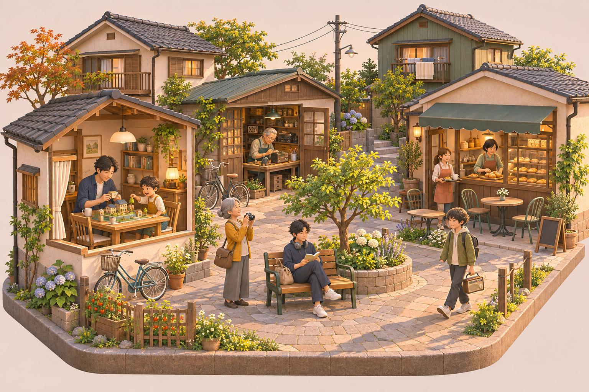
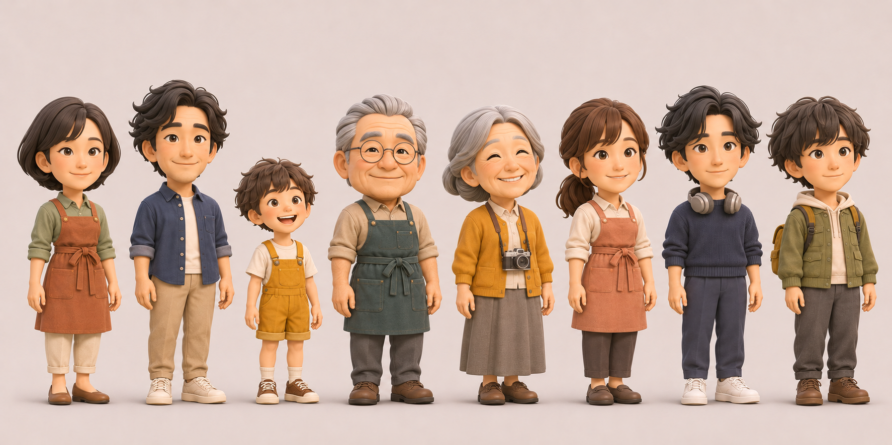
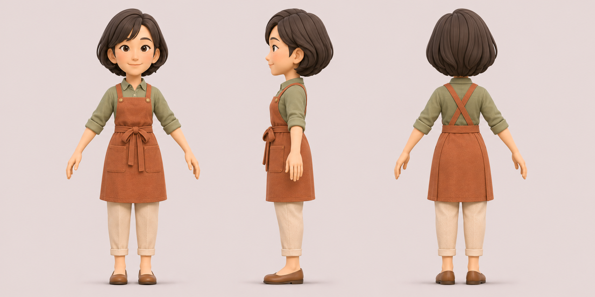
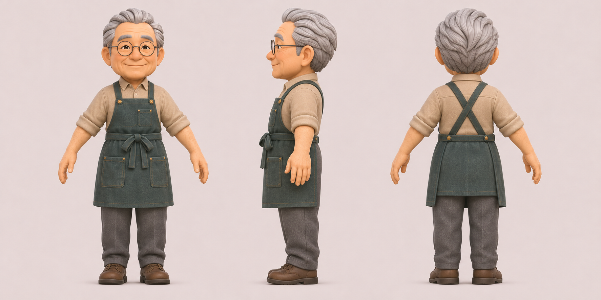
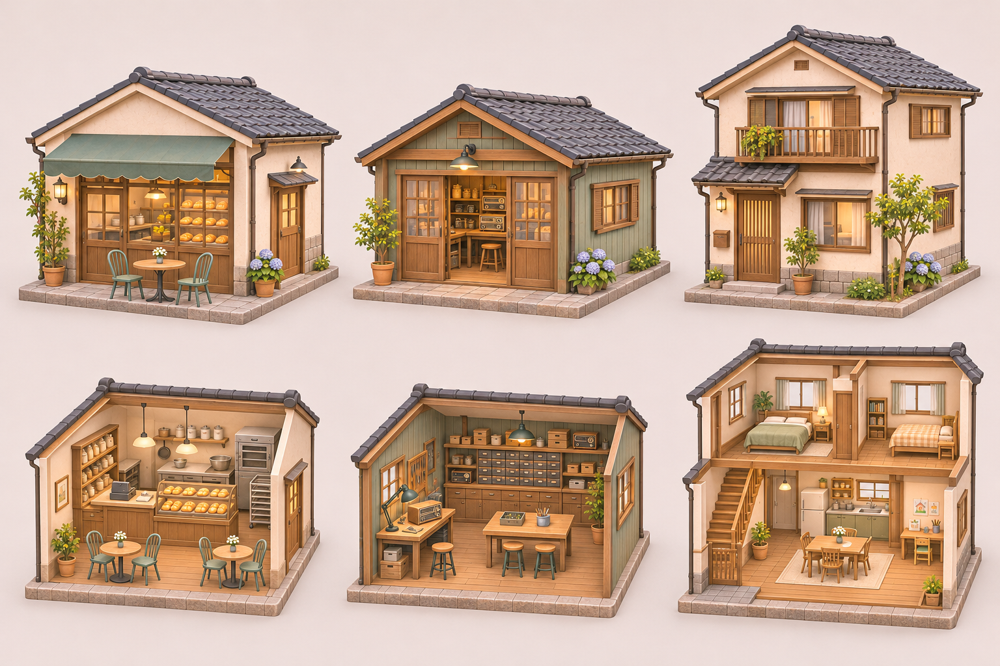
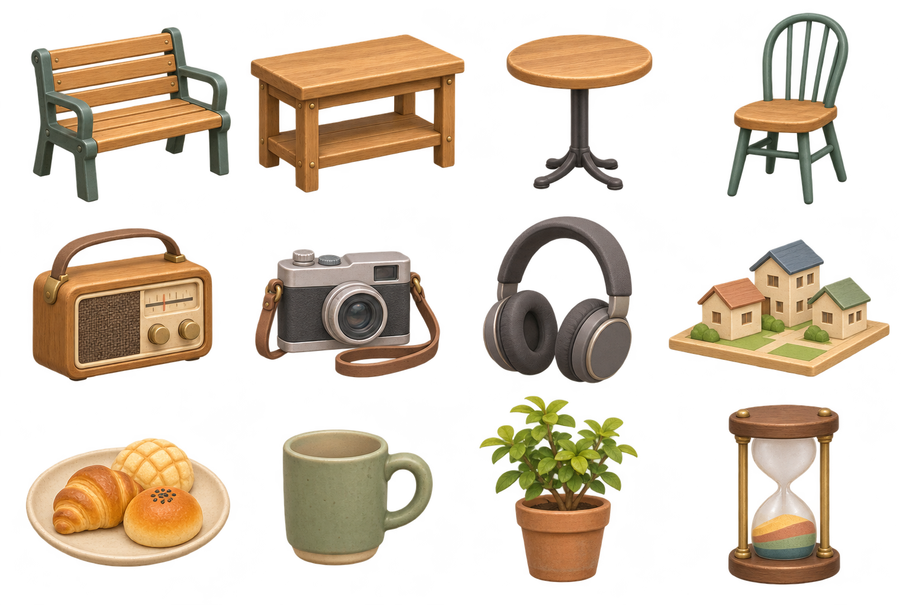

# 命の砂時計のアートワーク

2026年11月3日制作。3Dの人生シミュレーションに向けた、町、人物、建物、家具・小物の画像資料。内蔵の画像生成ツールで制作した。

最終画像は6点。3Dモデル、リグ、アニメーション、PBRテクスチャはこの一式に含まない。人物の三面図を形状の資料にし、集合図を人物の識別や相対的な身長の参考にする。

| ファイル | 内容 | 主な用途 |
|---|---|---|
| [01-town-overview.png](01-town-overview.png) | 町全体と日常の場面 | 町の雰囲気、配色、場所同士のつながり |
| [02-residents-lineup.png](02-residents-lineup.png) | 初期住人8人の集合図 | 髪型、服装、年齢差、見分けやすさ |
| [03-nagisa-turnaround.png](03-nagisa-turnaround.png) | 小川渚の正面・側面・背面 | 人物モデルと衣装の制作 |
| [04-osamu-turnaround.png](04-osamu-turnaround.png) | 佐伯修の正面・側面・背面 | 年配の人物モデルと作業着の制作 |
| [05-buildings-and-cutaways.png](05-buildings-and-cutaways.png) | パン屋兼喫茶店、工房、住宅の外観と断面 | 建物の形、生活空間、家具の配置 |
| [06-props-atlas.png](06-props-atlas.png) | 家具・小物12点の透過PNG | 小物モデルの制作、試作画面の素材 |

[生成プロンプト](prompts.json)には、町から各資料へデザインを引き継ぐ指定と、人物の頭身を調整した指示も保存している。[ファイル情報](manifest.json)には画像の大きさ、参照元、確認内容を記録する。

## 町

家、仕事場、喫茶店、広場を徒歩でつなぐ。家の中が見えるドールハウス表現と、外で過ごす時間を同じ画面に置く。

## 住人

集合図の左から、渚、亮、凛、修、文、真帆、律、葵。人物の行動や生活上の責任は[初期住人の設定](../../../data/residents.json)に対応する。衣装や髪型は今回の画像制作で加えた外見案。

| 順序 | 名前と設定ID | 外見の目印 |
|---|---|---|
| 1 | 小川渚 nagisa | 黒いボブ、セージ色のシャツ、赤茶の前掛け |
| 2 | 小川亮 ryo | 少しうねった黒髪、藍色の上着、ベージュのパンツ |
| 3 | 小川凛 rin | 子どもの小さな体格、黄色のオーバーオール |
| 4 | 佐伯修 osamu | 銀髪、丸眼鏡、濃い青緑の前掛け |
| 5 | 佐伯文 fumi | 銀色のボブ、黄土色のカーディガン、カメラ |
| 6 | 水野真帆 maho | 栗色の結んだ髪、生成りのシャツ、淡い珊瑚色の前掛け |
| 7 | 三浦律 ritsu | 濃紺の服、首元のヘッドホン |
| 8 | 高瀬葵 aoi | 少し長めの黒髪、苔色の上着、リュック |

## 建物

左からパン屋兼喫茶店、修理工房、住宅。上段に外観、下段に屋根や手前の壁を外した室内を示す。住宅は3世帯それぞれの間取りを作る際の共通の外観案とする。

## 家具と小物

4列3段の配置。左から右へ順に読む。各枠で見やすい大きさに描いてあり、物同士の縮尺はそろえていない。

| 位置 | 物 | ゲームでの用途 |
|---|---|---|
| 1段目1列 | 二人掛けのベンチ | 並んで座る、話す、静かに過ごす |
| 1段目2列 | 共用作業机 | 二人で制作する、道具を見せる |
| 1段目3列 | 喫茶店の丸テーブル | 食事、会話。椅子と組み合わせる |
| 1段目4列 | 喫茶店の椅子 | 一人分の着席位置 |
| 2段目1列 | 持ち運べるラジオ | 葵と修が関わるきっかけ、修理、贈り物 |
| 2段目2列 | カメラ | 文の趣味、町の記憶 |
| 2段目3列 | ヘッドホン | 律の音楽と一人の時間 |
| 2段目4列 | 町の模型 | 凛と亮の共同制作 |
| 3段目1列 | パンの皿 | 渚の仕事、食事、店での交流 |
| 3段目2列 | マグカップ | 飲み物、休憩、会話 |
| 3段目3列 | 鉢植え | 手入れの習慣、家や共用空間の飾り |
| 3段目4列 | 砂時計 | 人生を振り返る画面の意匠、卓上の小物 |

## 造形と質感

人物は3.5〜4頭身を制作時の目安とし、首、肩、肘、膝、手の動きを読める形にする。髪は大きな束でまとめる。服の細かな織りや髪の一本一本を、細かいポリゴンで作り込む必要はない。

木、布、陶器、塗装した金属を中心に使う。建物や物の角は少し丸め、使い方が分かる輪郭を残す。顔の表情だけでなく、手を止める、相手へ顔を向ける、隣へ座る動きが見える形を優先する。

町の絵は午後の暖かい光の参考。人物の三面図は、衣装の色や接続を見やすい照明の参考とする。ゲームの昼夜変化は、テクスチャへ強い影を描き込まず、照明側で表現する。

参考色は温かいクリーム、蜂蜜色の木、セージ、濃い青緑、赤茶、黄土色、灰色。画面全体を同じ茶色にせず、人物や道具を色で見分けられるようにする。

## 3D制作でそろえる点

人物は三面図をもとに、前掛けの紐、ポケット、髪の分け目、関節位置を各視点で合わせる。子どもは大人を一律に縮小せず、体格、家具への届き方、座る位置を調整する。

建物の断面図は間取りと物の配置の資料であり、寸法図ではない。入口、階段、椅子の周囲に移動経路を確保する。共用作業机は二人分の立ち位置を、ベンチは二人分の座る位置を別々に設ける。

小物シートは一枚の透過画像。各物を個別ファイルに切り出したスプライト集や、3DモデルのUVテクスチャではない。透過部分とガラスを保って使用する。
