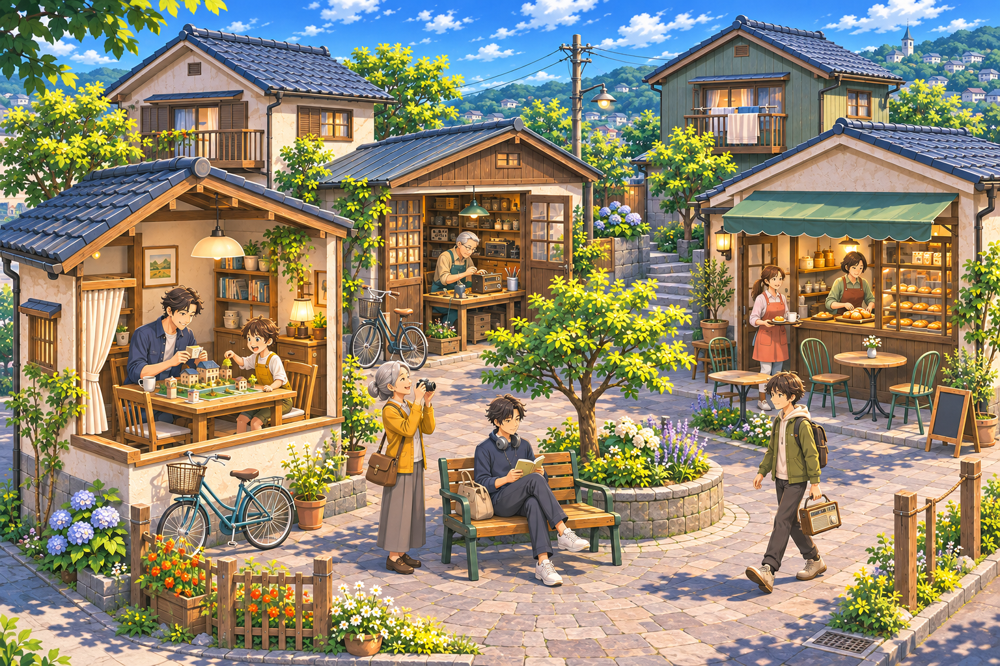
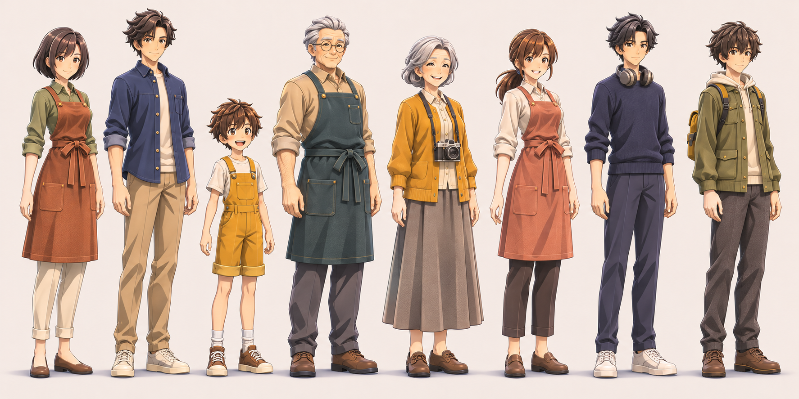
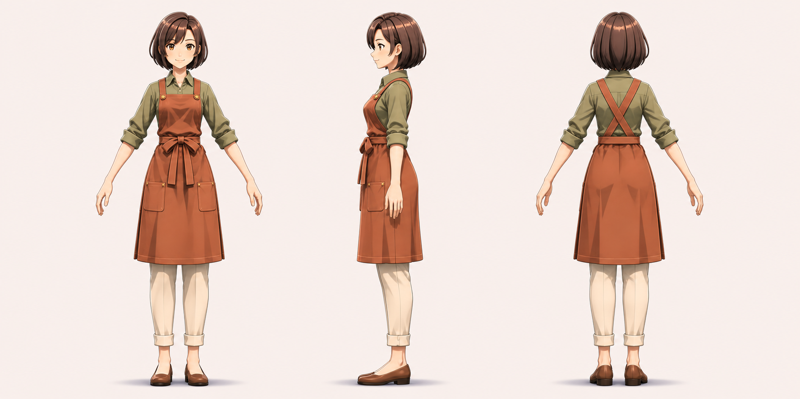
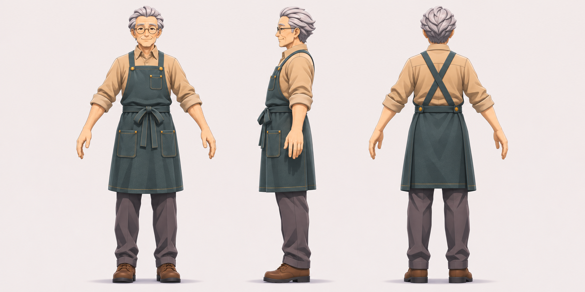
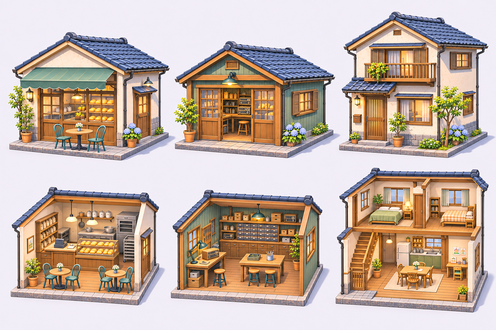
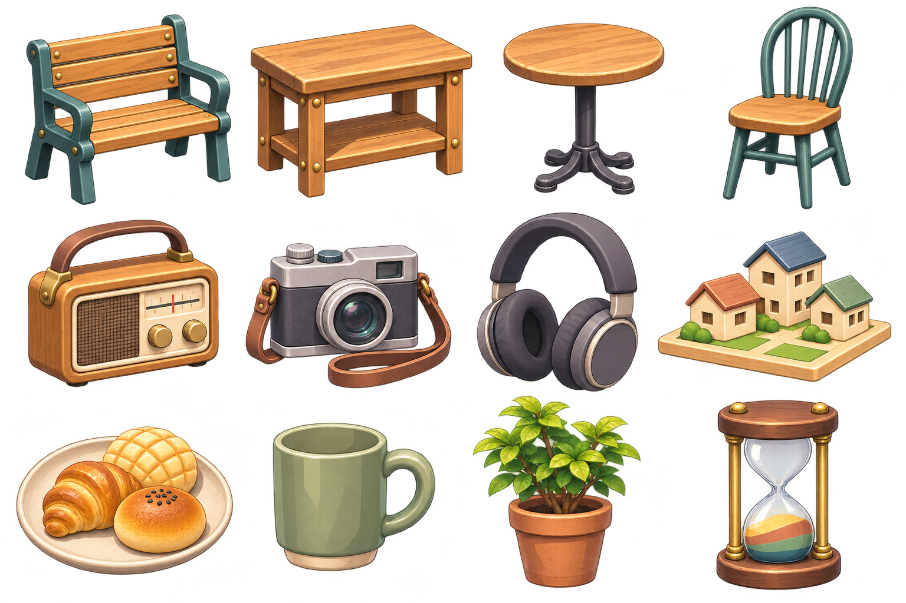

# 命の砂時計のJRPG調アートワーク

2026年11月3日制作。日本のJRPGらしいアニメ調3Dを制作方針とする。大人の頭身を6頭身前後へ上げ、細めの顔の輪郭、アニメ調の目、束感のある髪、面で切り替わる陰影、明るい色彩で統一した。

参考にしたのは、日本ファルコムが公開している[空の軌跡 the 1stのキャラクターページ](https://www.falcom.co.jp/sora/character/estelle.html)と[空の軌跡 the 2ndのキャラクターページ](https://www.falcom.co.jp/sora2/character/estelle.html)のゲーム画面。住人の年齢、職業、服の配色、町の用途は「命の砂時計」の設定を引き継いでいる。

内蔵の画像生成ツールで制作した最終画像6点。3Dモデル化前の画像資料であり、モデル、リグ、アニメーション、シェーダーの実装は含まない。

## 画像一覧

| ファイル | 内容 |
|---|---|
| [01-town-overview.png](01-town-overview.png) | 町全体と8人の日常 |
| [02-residents-lineup.png](02-residents-lineup.png) | JRPG調に描き直した住人8人 |
| [03-nagisa-turnaround.png](03-nagisa-turnaround.png) | 渚の正面、側面、背面 |
| [04-osamu-turnaround.png](04-osamu-turnaround.png) | 修の正面、側面、背面 |
| [05-buildings-and-cutaways.png](05-buildings-and-cutaways.png) | パン屋兼喫茶店、工房、住宅の外観と断面 |
| [06-props-atlas.png](06-props-atlas.png) | 家具・小物12点の透過PNG |

[生成プロンプト](prompts.json)と[ファイル情報](manifest.json)も収録している。以前のアートワークはv01として別に保存している。

## 町

青空、緑、屋根、木材、室内の光をはっきり描き分ける。生活の場所が道でつながり、仕事中、家族と一緒、一人で休むといった場面が同じ画面に見える構成。

## 住人

集合図の左から、小川渚、小川亮、小川凛、佐伯修、佐伯文、水野真帆、三浦律、高瀬葵。設定IDは順にnagisa、ryo、rin、osamu、fumi、maho、ritsu、aoi。

大人は5.5〜6.5頭身、子どもは4〜4.5頭身をモデル制作時の目安とする。年齢差や体格差は残し、髪型、顔、服のシルエットから人物を見分けられるようにする。

## 建物

左からパン屋兼喫茶店、修理工房、住宅。上段は外観、下段は屋根や手前の壁を外した室内。入口、作業台、椅子、階段を読み取りやすくし、住人の移動と交流に必要な空間を確保する。

## 家具と小物

4列3段の配置。左から右へ順に読む。各枠で見やすい大きさに描いており、物同士の縮尺はそろえていない。

| 段 | 左からの内容 |
|---|---|
| 1段目 | 二人掛けのベンチ、共用作業机、丸テーブル、椅子 |
| 2段目 | ラジオ、カメラ、ヘッドホン、町の模型 |
| 3段目 | パンの皿、マグカップ、鉢植え、砂時計 |

## モデルと描画の制作方針

髪は大きな束で形を作り、ハイライトを整理する。顔はアニメ調の目と小さな鼻を基本にし、表情と視線の動きが分かる立体にする。服は大きなしわ、襟、袖、前掛けの形を優先する。

肌、髪、服の陰影は少数の明暗面を軸にし、立体を補う緩やかなグラデーションを組み合わせる。輪郭線は形の判別を助ける程度に抑える。昼夜の光や影を素材の色へ固定しない。

三面図は形状の資料、集合図は人物の識別と相対的な身長の資料として使う。衣装の紐やポケット、関節位置はモデル化時に各視点でそろえる。建物の断面図は配置の資料であり、寸法図ではない。

小物シートは一枚の透過画像。物ごとの切り出し済みスプライトや、3DモデルのUVテクスチャではない。
