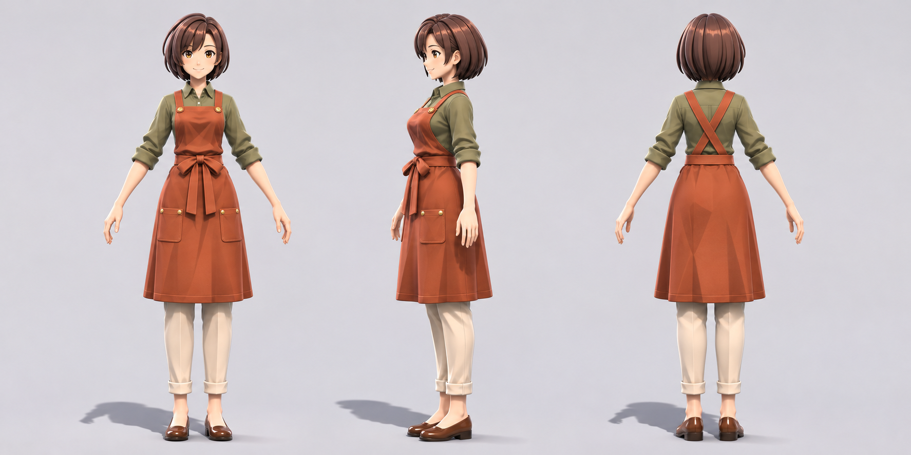
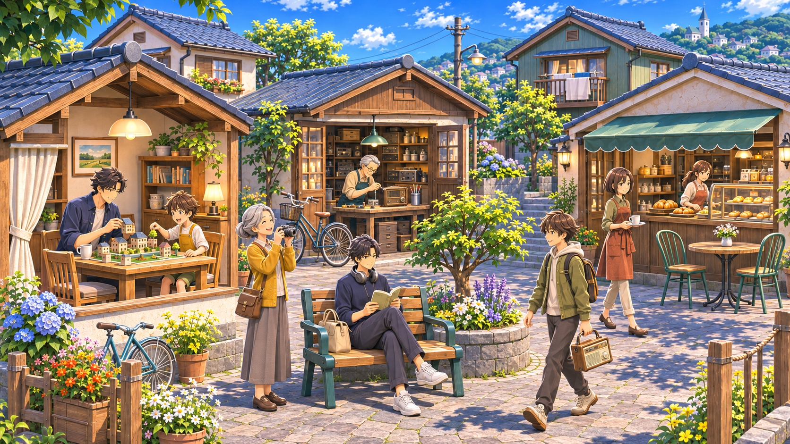

# JRPG調の立体表現の目標

住人の顔や服の配色を引き継ぎ、髪、顔、服の立体感を強めた追加アートワーク。内蔵の画像生成ツールで2026年11月3日に制作した。`v02-jrpg` の三面図と制作中の3Dモデルは維持する。

## 渚の立体表現

髪を立体的な束に分け、顔には整理したセル調の陰影、襟や前掛けの重なりには柔らかな影を入れる。大人の頭身と日常着を保ち、顔と身振りを読み取れる方向を目指す。

これは画像生成による制作目標であり、BlenderやGodotからの描画画像ではない。中央は依頼した斜め向きより側面に近く、正面と背面を含めた厳密な投影図でもない。素材と立体感の参考に使用し、寸法の正解として既存モデルを自動変更しない。

## 町の日常

家族の共同制作、工房、パン屋、読書、写真、町を歩く人を一画面へ配置した追加案。元の8人の髪型、年齢、服の配色を引き継ぐ。町の案は人物単体よりイラスト調が強く、生活場面と色彩の参考に使う。

参考作品は日本ファルコムの[空の軌跡 the 1st](https://www.falcom.co.jp/sora/character/estelle.html)と[空の軌跡 the 2nd](https://www.falcom.co.jp/sora2/character/estelle.html)。キャラクターと町は本作のオリジナル設定。生成に渡した画像は本作の既存アートワーク。

[使用した全プロンプト](prompts.json)と[画像情報](manifest.json)を収録する。実際のモデルと家具の描画は[ゲーム内の検証画像](../../../docs/verification/v0.5/activities/README.md)で確認できる。
