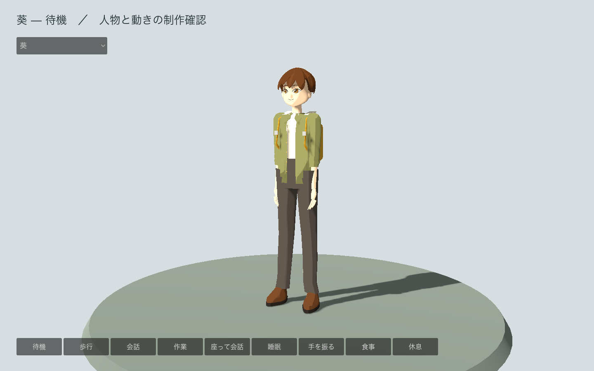

# CH_Aoi — 葵

2026年11月3日の制作途中の記録。Godotの町で使う人物モデルを用意した。原画への造形の最終一致、衣服と体の干渉、家具・道具との接触は継続中。

束のある髪、苔色の上着、生成りのフード、背中の黄色いリュックと肩紐。

## 原画と寸法

三面図を `ref/` に保存し、正面と側面と背面を切り分けた。身長 1.71m は架空の人物の設計値。1単位を1mとし、隠れた人体、服や持ち物の奥行き、顔の立体、動きは推定している。人物の統計や個人の成長予測ではない。

正面の原画と同じ実寸の窓へ合わせた輪郭IoUは **0.8827**、10区間の幅の差の最大値は全身高の **3.66%**。formsのIoU 0.90の基準には届いていない。頭身、腕、髪の輪郭、衣服の形を最終確認する。側面では腕を下ろし、正面では開いているため、側面の全身輪郭を同じ姿勢の寸法検査とは扱わない。`review/03_forms/world/` は実寸比較、`compare_front` は輪郭の矩形を合わせる別方式の比較であり、両者を混同しない。

## ゲームへ渡すモデル

| 段階 | 三角形 | 再読み込みした高さ |
|---|---:|---:|
| LOD0 | 30,008 | 1.70479m |
| LOD1 | 12,602 | 1.70480m |
| LOD2 | 3,599 | 1.70480m |

すべての段階で35本の骨、6表情、9種類の動き、2素材、埋め込み画像3点を保持する。待機、歩行、会話、作業、着席会話、睡眠、挨拶、食事、休息を用意し、歩幅と周期を人物ごとに設定する。髪だけの加齢表現を実際の描画画像で確認する。加齢した顔や姿勢の完成を意味しない。

素材は1kのオリジナルパレット。BaseColorはsRGB、ORMとOpenGL +Y NormalはNon-Color。外部の画像を参照せずGLBへ埋め込む。距離による自動LOD切り替えは未実装。

## 検査と残る作業

`review/06_validate.json` の失敗は 0、警告は 3件。警告は衣服や接合部の近接頂点として記録する。UV、加重の欠落、4本を超える加重、正規化、三角形の予算とコリジョンの閉鎖性を検査した。LODを削減した後には面の向きをそろえる。

`review/08_animation/geometry-checks.json` で中立の表情と変形量、全動作25時点の床とループの継ぎ目を確認した。`review/09_roundtrip/rest-contract-checks.json` では、空のBlenderに読み込んだ3種類のGLBで寸法、三角形数、骨、表情、クリップ時間、埋め込み画像と外部依存を照合している。

硬い持ち物は胸または頭に固定する。手でカメラや道具を扱う動作、椅子・食卓・寝床への姿勢の位置合わせ、自然な衣服の折れや重なり、原画に近い髪と顔、素材と照明の仕上げは未完了。機能検査の成功を造形の最終受け入れとは扱わない。

`_calibration.blend` は物差しと原画、`_canonical` は共通の制作空間、`_master` と `_forms` は体格の変換後、`_topology`・`_materials`・`_rig`・`_animation_master`・`_delivery` は工程ごとの保存。元の人体をHIGHへ残し、ゲームへはLOWの書き出しを渡す。再生成は[共通工程](../common/README.md)を参照。
