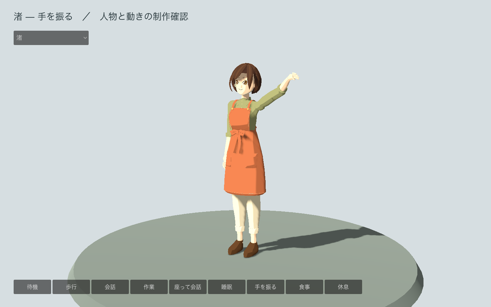

# CH_Nagisa — 渚のモデル制作

JRPG調の三面図をもとに、実際に動く3Dモデルへ進める代表例。2026年11月3日時点では制作途中。Godotの町へ取り込んだが、衣服と体の接触、家具との位置合わせ、照明と色、表情の見え方を含む最終受け入れは完了していない。



## 編集ファイル

- `CH_Nagisa_master.blend`: 原画、実寸の物差し、形状と衣装。元のクアッド形状を保持する。
- `CH_Nagisa_topology.blend`: 書き出し用の三角形メッシュ。体・髪・衣装と、目・眉・口を分ける。
- `CH_Nagisa_materials.blend`: オリジナルのパレットを使った2マテリアル。
- `CH_Nagisa_rig.blend`: 35本の変形用骨、6種類の表情、3段階のメッシュ。
- `CH_Nagisa_animation_master.blend`: ゲーム用の9クリップと、制作確認用の姿勢。
- `CH_Nagisa_delivery.blend`: 制作確認だけの姿勢を除いた書き出し用ファイル。
- `exports/`: GLB、素材と単位・骨・推定箇所を記載したmanifest、動きの契約。

1単位を1mとし、制作上の身長を1.65mと設定した。この実寸は推定。再読み込みした休止姿勢の高さは1.6454m、目標との差は約0.28%。人間の統計から推定した身長ではない。

## 原画との比較

正面・側面・背面を同じ縮尺で切り出し、背景と床の影を除いたマットで比較した。位置や縮尺を後から合わせないworld gateの結果は、正面IoU 0.9185、側面0.9103、背面0.9221。10区間の横幅の差は、いずれも全身の高さの2.41%以内。

外接矩形を合わせ直して256pxで測る比較はIoU 0.917、幅の差は最大1.57%。首元へ下がる髪の輪郭を修正し、正面比較の数値はforms工程の基準内へ収まった。衣服と体の接触、素材と照明、家具との位置合わせを含む最終受け入れは継続する。

正面の胴・前掛けと、側面の奥行きから形を作った。顔の奥行き、隠れた人体、衣服の厚み、手指、靴底、素材の反応、すべての動きは推定している。三面図自体にも腕の開きや裾の形に差がある。輪郭の一致度は顔の似方や動きの自然さを保証しない。

数値は `review/02_blockout/` と `review/03_forms/` に保存。正面の比較画像、固定視点のクレイ、回転画像も保持する。Blenderの実画面で `Fringe01` を編集し、幅を8%広げ、前へ6mm動かして保存した。その編集は `build/manual-scene-edits.json` にも記録し、再生成時に再現する。

## ゲームへ渡る内容

| 内容 | LOD0 | LOD1 | LOD2 |
|---|---:|---:|---:|
| 三角形 | 30,856 | 12,958 | 3,699 |
| 変形用骨 | 35 | 35 | 35 |
| 動き | 9 | 9 | 9 |
| 表情 | 6 | 6 | 6 |
| マテリアル | 2 | 2 | 2 |

動きは待機、歩行、会話、作業、座って会話、睡眠、挨拶、食事、休息。歩行はその場のクリップで、移動そのものはゲームが担当する。表情はまばたき、微笑み、悲しさ、疲れ、左右の視線。骨と表情の名前を変えず、遠景用も同じ操作で動かせる。

前掛けの裾を開き、ポケットと布の加重をそろえ、座ると腰の内側から見えていたズボンの被覆箇所を書き出し用コピーで除く。元のマスターには衣服と隠れた脚の人体を残す。LOD1/2は制作済みだが、町の距離による自動切り替えは未実装。

1kのBase Color、ORM、ニュートラルな接線空間NormalをGLBへ埋め込む。ORMはR=AO、G=粗さ、B=金属度。Base ColorはsRGB、他はNon-Color、法線はOpenGL +Y。色ごとの領域を共有するパレットUVで、各領域の縁から50px以上離して使う。顔や服に細かな織りを投影するUVとは異なり、同じ色の面でUVが重なるのは意図した設計。方向のある光や影は色へ焼き込まない。

接合部やまつげの角には重なった頂点があり、validateの警告として残る。未加重・4本を超える加重・正規化されていない加重、欠落UV、開いたコリジョン、三角形数の上限超過は検出されていない。前掛けは実時間の布計算を使わず、前後の骨と姿勢で動かす。最終確認では、検査が拾わない衣服の貫通も目視して修正する。

## 検証

`review/08_animation/geometry-checks.json` で、表情の中立値、変形量、ループの継ぎ目、25時点の床との関係を確認。全ループの始点と終点の最大差は0。歩行の検査時の最低点は床から5mmで、途中のキーも接地を補正する。

各GLBを空のBlenderへ再読み込みし、三角形数、35本の骨、6表情、9クリップの長さ、埋め込み画像3点、外部依存がないことを照合した。一般のroundtripツールは先頭の食事クリップを表示するため、表示中の高さは約1.29mになる。実寸の検査は別途アニメーションを解除した休止姿勢で行い、結果を `review/09_roundtrip/rest-contract-checks.json` に保存した。

Godotでは、実際のスキン、骨の歩行、着席による腰の下降、挨拶の腕、まばたき、遠景用の骨と表情、町でのモデル使用を確認。GPUで各クリップと3種類のモデルを描画し、通常の画面操作でも歩行・着席・挨拶へ切り替えた。

## 再生成

リポジトリのルートから実行する。`blender` は実行ファイルのパスに置き換える。数値・カラー比較の補助ツールには、ローカルの `blender-image-to-3d` スキルを使う。場所が異なる場合は `BLENDER_ASSET_SKILL` にスキルのルートを設定する。

```sh
bash tools/setup_asset_tools.sh
builds/asset-tools/bin/python assets/models/CH_Nagisa/build/00_reference.py
blender --background --python assets/models/CH_Nagisa/build/02_blockout.py
blender --background --python assets/models/CH_Nagisa/build/03_forms.py
blender --background --python assets/models/CH_Nagisa/build/04_topology.py
blender --background --python assets/models/CH_Nagisa/build/05_materials.py
blender --background --python assets/models/CH_Nagisa/build/06_rig.py
blender --background --python assets/models/CH_Nagisa/build/08_animation.py
blender --background --python assets/models/CH_Nagisa/build/08_check_animation.py
blender --background --python assets/models/CH_Nagisa/build/09_export.py
blender --background --python assets/models/CH_Nagisa/build/09_check_import.py
```

最初のマスターはスキルの `init_master.py` で作成した。既存のマスターへ02から再実行すると、該当工程の形状を再作成する。形状を手で追加編集した場合は、先に別名保存し、維持する変更を工程に記録する。04以降は前工程のコピーを開くので、同じ工程を重ねても変形やマテリアルを累積しない。

書き出したGLBをゲームの同名ファイルへコピーしてから、Godotでインポートする。`game/scenes/character_stage.tscn` では各動きを画面から選べる。`tests/test_character_model.gd` はヘッドレスでも実行でき、GPUで実行した場合は画面も保存する。
