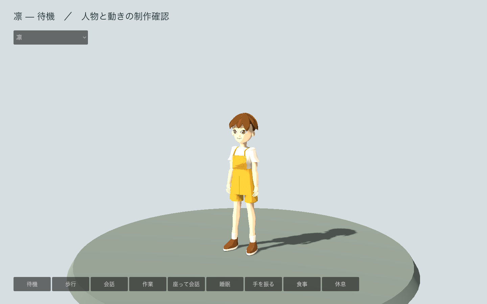

# CH_Rin — 凛

2026年11月3日の制作途中の記録。実際のGodotの町へ取り込んだが、造形と衣服・家具との接触の最終受け入れは未完了。

同じ人物の三面図を基準に制作。正面と背面では腕を開き、側面では下げているため、側面の全身輪郭を同じ姿勢として比較しない。

正面比較のIoUは 0.858、10区間の幅の差の最大値は全身高の 2.73%。formsのIoU 0.90の基準には届いていない。制作中の動きを町で調べるための取り込みであり、原画への最終一致を合格扱いにしない。衣服の重なり、顔や髪、素材と照明の見え方を引き続き確認する。

## 編集用ファイルと実寸

`CH_Rin_calibration.blend` は実寸の物差しと原画、`_canonical.blend` は共通の制作空間、`_master.blend` と `_forms.blend` は人物ごとの体格を反映した形状。`_topology`、`_materials`、`_rig`、`_animation_master`、`_delivery` を工程ごとに保存する。元の人体をHIGHへ残し、ゲーム用のLOWと分ける。

身長の設計値は 1.22m。以下は空のBlenderへGLBを再読み込みし、動きを解除した休止姿勢で測定した値。寸法は架空の人物の制作設定であり、公的統計から推定した個人の体格ではない。

| 段階 | 三角形 | 再読み込みした高さ |
|---|---:|---:|
| LOD0 | 30,164 | 1.21654m |
| LOD1 | 12,666 | 1.21656m |
| LOD2 | 3,610 | 1.21653m |

各段階で35本の骨、6表情、9クリップ、2マテリアル、埋め込み画像3点を保持する。動きは待機、歩行、会話、作業、着席会話、睡眠、挨拶、食事、休息。表情はまばたき、微笑み、悲しさ、疲れ、左右の視線。LOD1/2の骨と表情をGodotでも再生した。町での距離による自動LOD切り替えは未実装。

素材はオリジナルの色領域をまとめたパレット。BaseColorはsRGB、ORMとOpenGL +YのNormalはNon-Color。1k画像をGLBへ埋め込み、外部画像へ依存しない。Godot側の段階的な陰影と、髪だけの加齢表現に使う。昼夜の光は色へ焼き込まない。

## 検査と残る確認

`review/06_validate.json` の失敗は 0。未加重、4本を超える加重、正規化されていない加重、UV不足、開いたコリジョン、予算超過は検出されていない。衣服の接合・縁などの近接頂点について 3件の警告があり、記録を保持する。

`review/08_animation/geometry-checks.json` で表情の中立値、変形量、全ループの継ぎ目、各クリップ25時点の床との関係を検査。`review/09_roundtrip/rest-contract-checks.json` で三角形数、骨、表情、クリップ時間、埋め込み画像、外部依存のないことを照合した。Godotでは実際のスキンと骨、着席・挨拶、LOD、成長の切り替えをheadlessとGPUで確認している。

合格した機能検査は、布のすべての貫通や自然な接触、顔の似方、遊び全体の品質を保証しない。椅子・机・道具への位置合わせ、加齢後の顔や姿勢、全8人の表現と町全体はv0.5の残作業。

再生成は[共通工程](../common/README.md)を参照。`tools/prepare_resident_assets.py` がprofileと原画・測定値・工程の入口を用意し、`build/` の番号付きスクリプトが編集用ファイルとGLBを再構築する。
