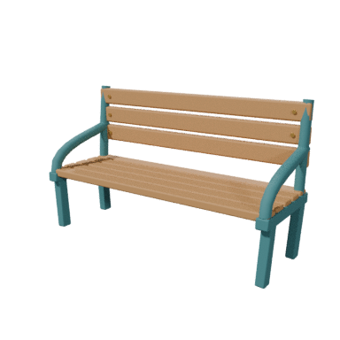

# 暮らしの家具と小物の3Dモデル

木と青緑の金属を基調にした、オリジナルの家具・小物10点。JRPG調の[小物原画](../../artwork/v02-jrpg/06-props-atlas.png)と[建物の断面](../../artwork/v02-jrpg/05-buildings-and-cutaways.png)を参考に、Blender 5.2.1で制作した。実際の町の着席、食事、作業、睡眠に使用する制作途中のモデル。

| モデル | 三角形数 | 使用場所 |
|---|---:|---|
| Bench | 3,584 | 広場の二人掛けベンチ |
| Chair | 1,980 | 家庭と喫茶店の食卓 |
| RoundTable | 1,224 | 家庭と喫茶店の食卓 |
| Worktable | 2,304 | 家庭、工房、パン屋、広場 |
| Bed | 1,296 | 住人ごとの寝床 |
| Footstool | 216 | 子どもの足元と作業台 |
| Radio | 1,372 | 修理工房 |
| TownModel | 672 | 小川家の共同制作 |
| BreadPlate | 2,108 | パン屋と食卓 |
| Mug | 460 | 食卓と食事中の手元 |

各GLBは1素材、256pxの画像3点を埋め込み、外部画像に依存しない。BaseColorはsRGB、ORMはNon-ColorでR=AO、G=roughness、B=metallic、NormalはNon-ColorのOpenGL +Y。照明を固定して焼き込まず、色の区画へUVを配置する。

編集元の `PR_LifeFurniture_forms.blend` は部品を分けて保持し、`PR_LifeFurniture_delivery.blend` のEXPORTには統合した出力用コピーを置く。1単位は1m、BlenderはZ上・−Y正面、GLBを読み込んだGodotではY上・+Z正面。原画は透視図のため、寸法、背面、接合部、ベッドの構造は推定。制作時の目安と実際の出力寸法は[manifest](exports/asset-manifest.json)で区別する。

## 確認と残る差

10点の合計は15,216三角形。全点を空のBlenderへ再読み込みし、寸法、三角形数、埋め込み画像数と外部依存のないことを確認した。[再読み込み結果](review/roundtrip.json)。全点で12,000三角形以下、UVとキット全体20,000三角形の検査は失敗0。

[検査の警告](review/04_validate.json)は保持する。近接する頂点、内部のメッシュ名の数値接尾辞、Bedの72面・Radioの48面・TownModelの24面の面積ゼロに関する警告が残る。衝突用メッシュは含まず、移動にはGodot側の家具の占有範囲を使う。

代表となるベンチを固定視点・推定した原画視点・128px・8方向で確認し、出力素材でも12方向と128pxの描画を保存した。ほかの9点も出力素材の透視図と128pxを保存。ベンチの[原画比較](review/03_forms/compare_bench.png)はIoU 0.523、縦横比の差+0.1719で、形状の受け入れ基準に達していない。透過原画の薄い影も輪郭に含まれ、原画とカメラの推定差も残るため、最終形状の一致を合格扱いにしない。



## 再生成

番号付きスクリプトはプロジェクトのルートから実行する。各スクリプトは前段階の保存ファイルを開く。

```sh
blender --background --python-exit-code 1 --python assets/models/PR_LifeFurniture/build/02_blockout.py
blender --background --python-exit-code 1 --python assets/models/PR_LifeFurniture/build/03_forms.py
blender --background --python-exit-code 1 --python assets/models/PR_LifeFurniture/build/09_export.py
blender --background --python-exit-code 1 --python assets/models/PR_LifeFurniture/build/09_check_import.py
blender --background --python-exit-code 1 --python assets/models/PR_LifeFurniture/build/05_review_materials.py
```

生成・確認用スクリプトは `BLENDER_ASSET_SKILL`、未指定なら `~/.codex/skills/blender-image-to-3d` の補助スクリプトを使用する。家具の配置と接触位置は `game/scenes/activity_layout.tscn` と `bench.tscn` に保存する。[ゲーム内の確認](../../../docs/verification/v0.5/activities/README.md)を参照。
