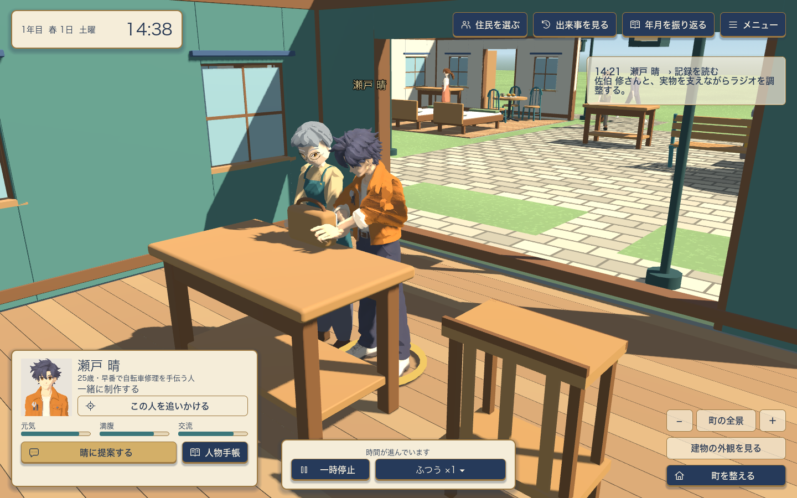
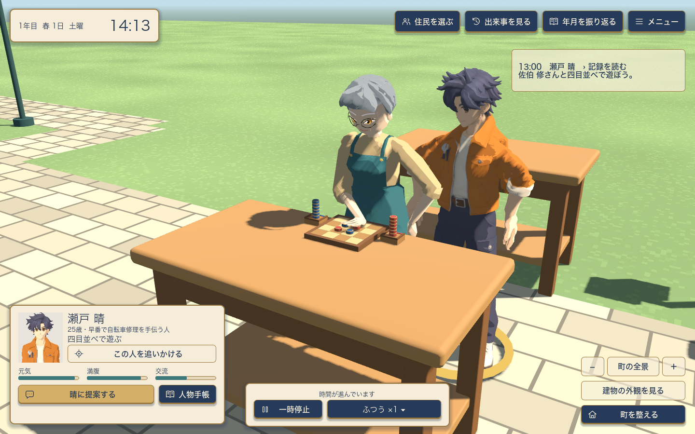
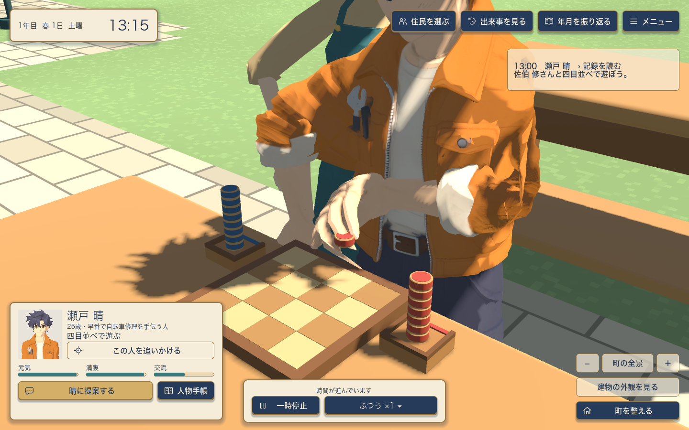

# 物を扱う生活モーションの実装と確認

2026年11月4日。対象は12人の町での、ラジオの取り出し・運搬・共同調整・返却、四目並べ、会話の番と上体、晴・咲・智・結衣の歩行支持。状態検査、実描画、エージェントによる配布アプリの操作を記録する。人による楽しさの評価は含まない。SHA/ハッシュは版の識別だけに使い、合否や検査件数に含めていない。

## 実装した一連の行動

ラジオは棚の1台を予約し、同じ物を手で持ち上げ、経路を歩き、台へ置く。支える人とダイヤルを調整する人を分け、実作業だけが材料・制作結果・技能へ反映される。終わった後も同じ物を棚へ返し、保持と予約を解放する。運搬途中の保存からMainの人物を再構築しても、その物と工程を引き継ぐ。

[ラジオのGPU検査32件](radio-gpu.json)と[ログ](radio-gpu.log)は、実際のMain・12人・経路・家具・同一物による制御fixture。7工程で実際に修正を受けた手首と掌をSkeletonの更新通知中に採取し、各目標から4cm以内、台への接地1mm以内を確認した。目標点だけを接触として数えていない。

四目並べは4×4の盤と16個の色駒、合法手・交互の手番・勝敗・反応・片付けを持つ。本人が勝てる手や阻止する手を考え、トレイの実駒をつまみ、セルへ置き、終わると1個ずつ返す。既知の近傍相手への自発的な誘いも行動候補へ接続し、両者の同意・余裕・先約と冷却時間を守る。

[GPU62件](tabletop-gpu.json)と[headless62件](tabletop-headless.json)では、大人の対局全体と凛の初手を確認。16個のIDと表示ノード、駒の所在、交互の合法手、実配置と片付け、途中保存と人物再構築を追跡した。指腹は実meshの末端から測り、修正後の親指・人さし指の実骨姿勢から算出。駒の両面とのずれ6mm以内、把持中心1cm以内、接近・離す途中の手首4cm以内を別々に確認した。これは骨から算出する測定点の検査で、手全体のメッシュ干渉を完全に証明するものではない。

通常craftと常設の積み駒が同じ作業面を使い、実際の手が駒へ入る問題があったため、遊ぶ机と制作机を分けた。3秒の同じ制御採取で、保守的な実skin頂点の駒内部への侵入診断は57から0となった。[前の記録](craft-before.json) / [分離後](craft-after.json)。これは限定場面の診断で、全活動の衝突検査ではない。通常craftの実材料・工具・加工工程は今後の対象である。

## 身体と見た目

[会話のGPU42件](conversation-gpu.json)では、実ベンチで晴/咲・智/結衣を合流させ、話す役と聞く役、胸・首・頭の相手方向、足の接触を確認した。会話の実経過8分で番が変わり、描画だけでは住民状態や乱数を進めない。

[4人の歩行支持のGPU検査](foot-plant-gpu.json)は、支持固定の前後を同じ直進・旋回・停止経路、速度0.65/1.2/2.16m/s、30/60fpsで比べた。支持中の足の滑りを80%以上減らし、残りを0.08m/s未満、IK残差を5.5cm未満にする基準を使用。停止・旋回・位置の大きな補正で古い固定を残さないことも確認した。旧8人への支持区間の校正は残る。

晴の指間が三角形に伸びる問題は、接続面が別々の指へ100%ずつ割り当てられていたため、手の局所ウェイトを連続化した。実変更はLOD0/1/2で721/479/187頂点。原型の形状・UV・骨・bind・クリップ・画像を変えず、最大4影響、同位置UV境界、末端指腹を維持した。[同じ把持姿勢のCPU診断](hand-weights.json)では、最大辺伸長率が5.18→2.19、2.77→2.63、1.78→1.43へ減った。これだけで見た目を受け入れず、同じ実ゲームの把持を再描画して比較した。

[Blenderへのclean reimport](hand-master-roundtrip.json)でも3LODの35骨、9クリップ、未割当0、最大4影響、linear skinningを確認。古いDelivery.blendは後のLOD位置と一部1.5mm違ったため、元を保存したまま現在のdeliveryから別masterを構成した。新規造形や参照画像との一致を再受け入れしたものではない。指は1指1骨の中間仕様であり、解剖学的な関節、細かな握り、袖・指の形の仕上げは残る。

## 生活・保存・操作

[現在の配置での焦点確認](layout-checks.json)には認知・現行保存、世界の物、卓上ルール、家具、提案、環境、10seedの自律生活比較を含む。[追加の動作確認](motion-checks.json)には卓上の表示、会話、カメラ、自然な紹介→共同制作→学習の連鎖、人口UIを含む。個別の修正後に実行した記録であり、すべてを同時に人が試遊した結果ではない。

広場の近距離移動が机を横断する問題も修正し、実配置したベンチから机への往復を、体幅を含む5mm間隔の線分採取と実移動で確認した。遮られた近道は街路と家具の角を回り、通れる近道は保つ。人同士の混雑・譲り合いまで解決したとはしない。

保存はschema7。開発中は下位互換を捨ててよいという方針に従い、旧配置の保存を現在の遊び専用机へ戻さず、読み込みを拒否して新しい町の開始を案内する。現在の形式では各工程からの保存・再開、保持者の死去・退出、結果の一度だけの記録を検査している。実配布アプリで旧保存の案内がタイトル裏のHUDへ隠れる問題を見つけ、タイトル上のダイアログへ変更した。[headless/GPU各7件の確認](load-results.json)は隔離した旧形式/現行形式の保存を実際の「つづきから」の処理で開き、案内の可視性と文字/背景の明暗差、町と保存内容の保全、現行保存の成功を確認する。

画面の「−」「＋」「町の全景」とピンチ/パン入力、停止中のカメラ、UI上での遮断を追加した。[実画面のUI統合](scene-ui-gpu.log)は共同作業の実返却まで確認。物理トラックパッドによるピンチ/パンは未確認であり、合成入力と区別する。

ユーザーの途中ビルド依頼で用意した[中間Mac版と配布アプリの実操作](checkpoint/)は、この後の指腹・手ウェイト・机分離・schema7を含まない。中間版を残して開発を継続した。

## 全検査と更新した配布物

[全エンジン確認の台帳](all-engine-checks.json)は、旧互換テストを現行方針へ直した後の全項目の実行結果。各scriptの完了markerと終了、engine errorなしを確認し、importも別の行で記録している。検査数を人による品質受け入れの代わりにはしない。

[更新したMac版の実操作とパッケージ](playable/)も確認した。中間版後の指腹・手ウェイト・机分離・保存案内の修正まで含む。旧保存は事前保全し、確認後に元へ戻した。

## 次に残す品質課題

6制作すべての実材料・工具と加工途中の変化、着席/起立とカップの取り出し/返却、寝具、屋外の遊び、旧8人の歩行支持、衣服・髪・指の仕上げ、混雑の譲り合いを続ける。卓上は主fixtureの大人1組と子どもの初手の測定であり、13体格全員の全対局の描画検査ではない。普通の町で自発的に選ばれる遊びを長く見守る試遊、物理トラックパッド、初見の人が動きから意図を理解し続けて見たくなるかの確認も必要である。
