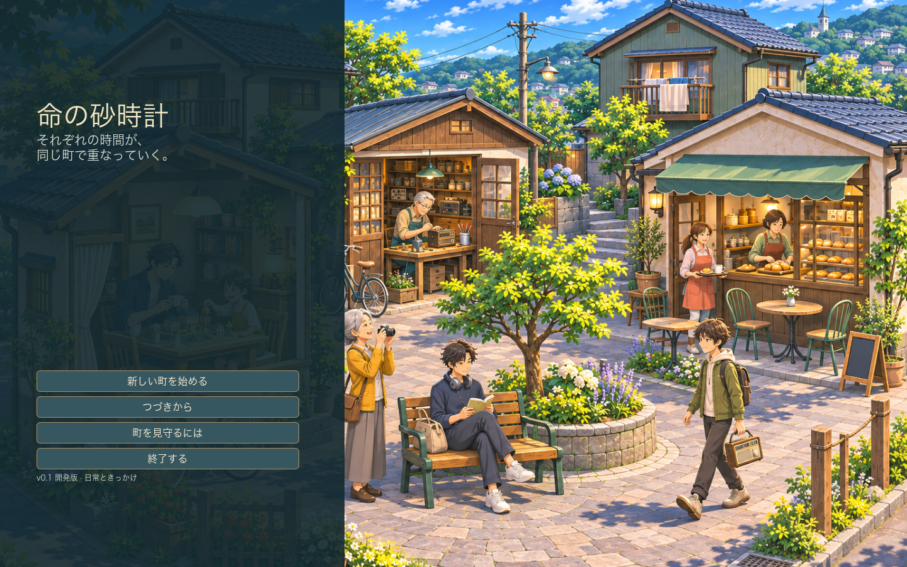
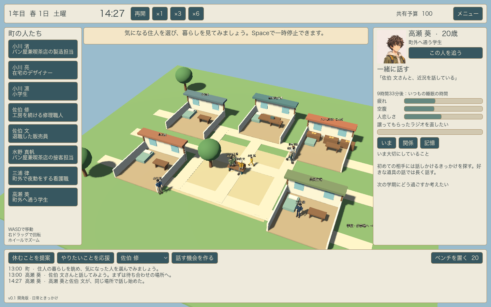
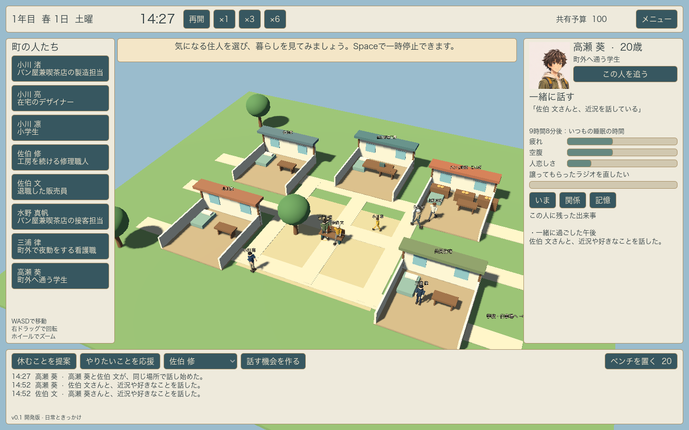

# v0.1 検証記録

2026年11月3日。macOS、Apple M5、Godot 4.7.2、Compatibilityレンダラーで検証。

## 確認できた動作

- シミュレーションの49項目が成功。8人の読み込み、交流の受諾、実移動、合流、会話時間、双方の記憶、予定による中断、夜勤の翌日への継続、昼間の睡眠、保存と再読込後の同一の乱数系列と行動、家具配置と予算、7日間の進行を含む。
- GPUを用いたシーン・UI確認が成功。開始画面、8人のシーンと選択一覧、歩行クリップによる関節の変化、会話の着席クリップ、追従操作、メニューの一時停止、記憶タブの表示を確認。
- ネイティブの画面操作でも、開始、人物の観察、交流の提案、ベンチ配置、倍速、追従、記憶表示、メニューでの保存、タイトルからの再開を確認。配置した2台目のベンチ、共有予算80、葵と修の交流の記憶が復帰後も残った。
- Godotのシーンエディタで `main.tscn` のCameraを選択し、インスペクターでFOVを43度から48度へ編集して保存。実行シーンにも48度が保存されていることをファイルで確認した。
- 画面で見つかった露出の強さを、DirectionalLightとWorldEnvironmentの光量・トーンマップで調整。調整後の画像は以下。
- macOSのユニバーサルアプリをエクスポートし、ZIPを展開して実際に起動。エディタから独立したアプリでも日本語、タイトル、3Dの町、既存セーブの読込、記憶タブ、予算80と2台のベンチの復帰を確認した。署名・公証は未実施。

## この版で完成扱いにしないもの

人物、家具、室内、町は操作と生活の成立を確かめるための仮モデル。アートワークに示したJRPG調の最終形状、衣服、髪、表情、共同作業、音はv0.5で仕上げる。長期の人生、仕事と家庭の相互支援、関係に応じた約束と習慣も後続版の対象。

通路は街路グラフで移動する。家具や人物同士の局所的な回避、睡眠位置とベッドの整合は未完成。macOS以外の実機、操作機器、長時間の耐久、ゲームとしての面白さは、この記録だけでは確認済みとしない。
