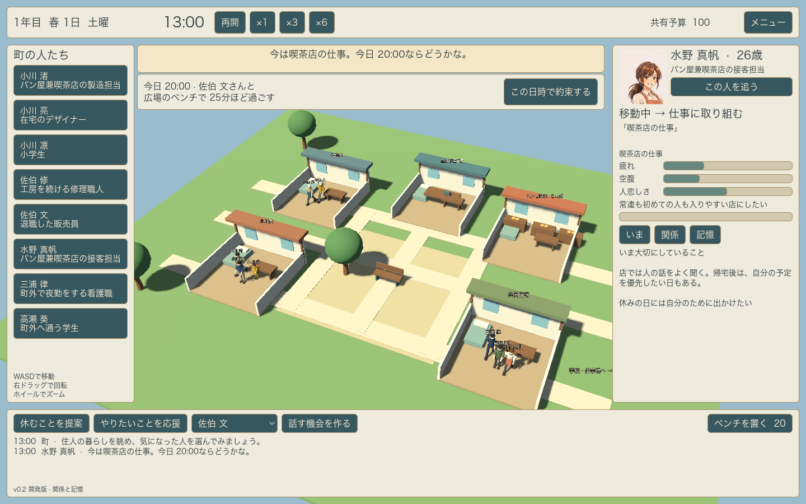
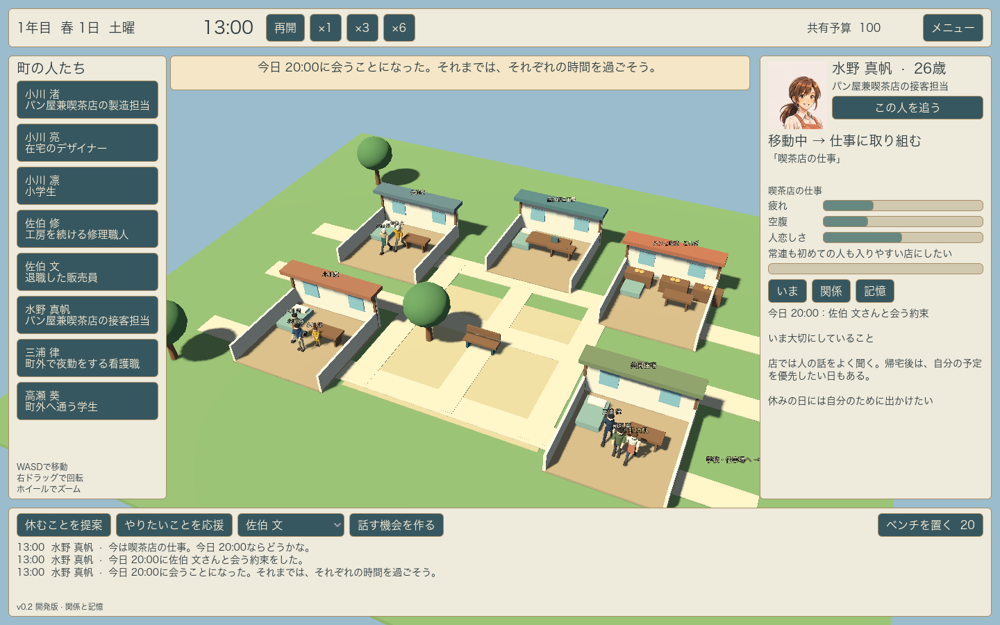

# v0.2 関係と記憶

この版では、以前の体験が次の選択に影響することと、忙しい相手との別案を実際の約束につなげることを中心に実装した。

## 遊びの変化

忙しい人に交流を提案すると、二人の日課と移動時間が重ならない日時を探して別案を返す。HUDの別案には日時、相手、場所、長さが表示され、「この日時で約束する」で確定できる。住人はその時刻まで自分の生活を続け、約束の前に実際に待ち合わせ場所へ向かう。早く着いた場合は予定の時刻まで待つ。

予約しただけでは交流の記憶を作らない。二人の合流と会話の時間を確認してから約束を果たしたと記録する。疲れ、外せない予定、場所の混雑、移動の都合で会えなかった場合は、日を改めた経験として残す。会話をしたという記憶や、果たした約束の効果は付けない。

親しみ、気安さ、信頼、話し残したことが、同じ場所にいる相手への関心と、交流への返答に影響する。静かに過ごしたい人は、慣れない相手にはいつもの喫茶店で短く会う別案を出すことがある。会話の内容は二人の関心から決まり、同じ出来事でも本人の過去に応じて受け止め方が違う。同じ日の連続した交流は関係への変化が小さくなる。

自由な時間に、同じ時間帯・場所で20分以上過ごす行動を別々の3日で繰り返すと習慣として見えるようになる。習慣はその条件での次の行動を少し選びやすくする。職業や性別で習慣を固定せず、実際の暮らしから生む。

## 検証

2026年11月3日、Godot 4.7.2、macOS、Apple M5で実行。

- 日常と移動、日をまたぐ予定、会話の成立、保存後の乱数と行動の継続など、従来の49項目が成功。
- 約束、空き時間、予約だけでは増えない記憶、予定に向けた実移動、実際の履行、親しい相手と慣れない相手への違う返答、双方で違う受け止め方、予定変更、複数日にわたる習慣、条件に応じた影響、保存と旧版の移行、不正な保存データの拒否など、追加33項目が成功。
- GPUを使い、別案のHUDを表示し、ボタンから約束を確定し、人物画面に予定が現れるところまで確認。タイトル、3Dの人物、歩行と会話のクリップ、記憶表示も継続して確認。
- macOS用のアプリをZIPから展開して起動。真帆が仕事中に「今日20:00に渚と広場で」という別案を返し、画面上のボタンで確定して保存した。タイトルから再開しても、真帆の人物画面に同じ約束が残ることをネイティブの画面操作で確認。

保存は新しい `user://life-save.json` を使用する。新しいファイルがない場合にはv0.1の `user://life-save-v01.json` も読める。旧版には存在しなかった約束や習慣を、移行時に過去の出来事として創作しない。

人物・町は引き続き仮モデル。収入や家事・世話が生活を変える条件はv0.3、年月と人生の変化はv0.4、JRPG調の完成モデルと演出はv0.5で進める。
