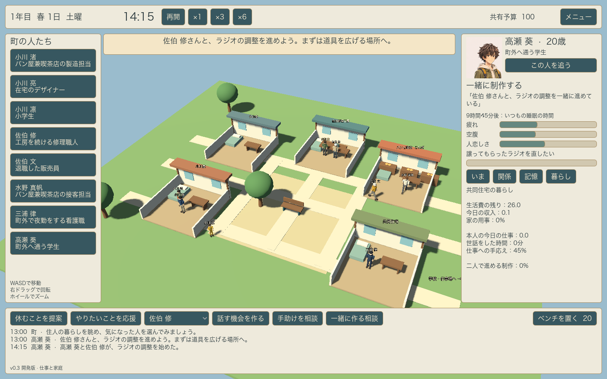
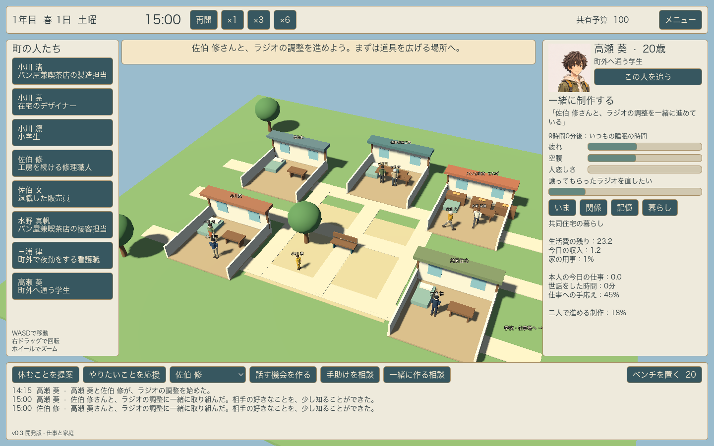

# v0.3 仕事と家庭

この版の中心は、自由な時間の使い方を、性格だけでなく生活の条件から選ぶこと。

## 暮らしの条件

仕事は実際に働いた分だけ世帯の収入になる。移動中には賃金を付けない。食事、制作の材料、日々の生活費、季節ごとの住居費を支払い、世帯の記録へ残す。小川家、佐伯家、共同住宅で収入と支出が異なる。職業による手応えと本人の仕事の目標も別に進み、仕事を単なるお金稼ぎだけにしない。

家の用事は暮らす人数に応じて増え、実際に片付けると減る。誰が選ぶかを性別で固定しない。生活費の余裕が少ないときは、架空の設定上で勤務を調整できる亮と修に、追加の仕事が選択肢として現れる。休息を優先する条件はそのまま残す。

金額や収入率は現実の円、給与、年金、奨学金の水準を表さない。`data/life-conditions.json` に記したゲーム用の調整値。統計から個人の金額を推定した値ではない。

## 世話と支援

凛は平日の下校後に家で過ごし、亮が世話をする。プレイヤーは、信頼する大人へ手助けを相談できる。相手の予定、疲れ、一人で過ごしたい気持ちも返答に反映する。子どもを大人の代わりの世話役にしない。

引き受ける返事だけでは亮の責任を解除しない。手伝う人と凛が実際に家にそろってから、亮が自由な時間を使える。交代の終わりに亮がまだ外にいる場合には、戻るまで手伝う人が残る。相談しただけ、移動しただけの支援を、完了した記憶として数えない。

## 一緒に進めるもの

葵と修のラジオ、亮と凛の町の模型、渚と真帆のパン、文を交えた写真、律を交えた音楽など、相手に応じた制作を相談できる。二人が合流し、45分の作業を終えると、関係する本人の願いや私的な制作が進む。材料は作業を始めるときに使う。仕事上の目標と私的な目標を混同せず、亮と凛の模型づくりは世話をしながら一緒に過ごす時間にもなる。

## 検証

2026年11月3日、Godot 4.7.2、macOS、Apple M5。

- 日常49項目、関係と記憶33項目が継続して成功。
- 仕事と家庭の追加39項目が成功。移動と実労働の違い、家事による負担の変化、材料と資金、実際の到着を伴う世話の交代、交代のための帰宅待ち、疲れによる辞退、子どもへの役割の押し付けの拒否、共同制作、親子の世話と制作の両立、家計の記録を含む。
- 支援へ向かう途中で保存してから500分進めた状態と、同じ保存を読み直して500分進めた状態が、人物、支援、家計、社会的な履歴、乱数まで一致することを確認。
- GPUを使うシーン・UI確認が成功。「一緒に作る相談」ボタンから二人を移動させ、共同作業のAnimationPlayerクリップ、「暮らし」タブ、作業後の本人の目標への反映を確認。
- macOS向けのZIPを展開した独立アプリでも起動し、葵から修へラジオの共同制作を提案できることを、ネイティブの画面操作で確認。

人物、家具、町は引き続き仮モデル。年月と役割の変化はv0.4、JRPG調の完成モデル、位置合わせ、表情、音と演出はv0.5で進める。
