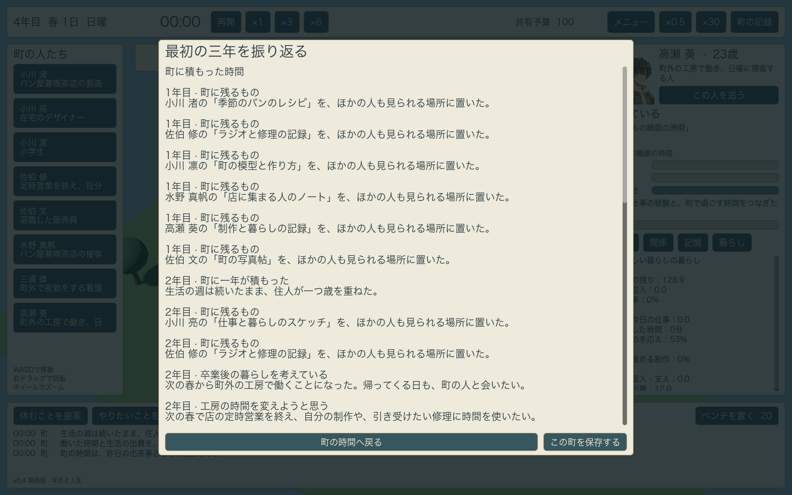
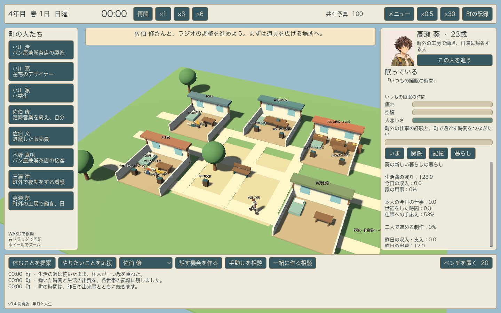
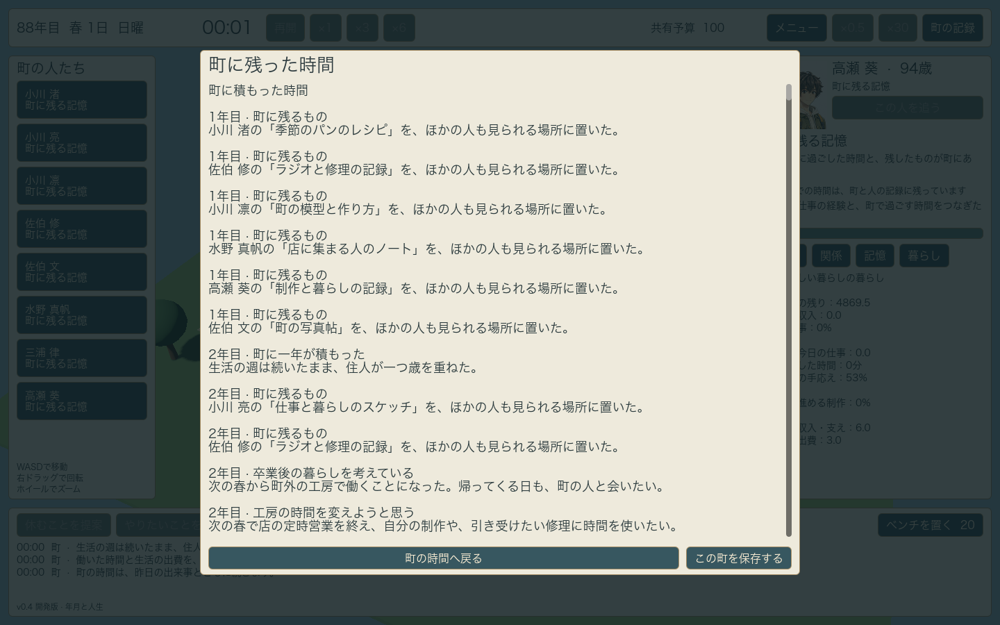

# v0.4 年月と人生

この版は、時間の経過を日付の表示だけにせず、会える条件、仕事や家庭の役割、本人の願い、町に残ったものへつなげる。

## 変わる暮らし

12代表日で一年が進み、生活の7日間の週は途切れない。最初の節目は、葵の卒業・転居と、修の工房の定時営業終了。本人が事前に予定を知り、親しい相手にも知らせる。その予定を知らない人へ、自動で同じ知識を与えない。会える期間を意識した交流や制作の選びやすさは、本人の価値観によって異なる。

葵は実際に町外へ移動し、別の世帯の生活費と勤務を持つ。町で会える時間は日曜12:00〜18:00に変わり、都合のよい日に帰ってくる。修は定時の受付を終え、自分の制作や引き受けたい仕事を選ぶ。成長した凛は下校後の固定の過ごし方から離れ、亮も初期の世話の時間に縛られなくなる。さらに年月を重ねると、就学から仕事、その後の働き方の変更へ進む。

年代や生涯の終わりは、`data/life-course.json` に置いた架空の物語の設定。実在する人の寿命、卒業や退職の年齢、給与・年金を推定するモデルではない。本人の判断には、内側にある寿命の値を渡さない。

## 残るもの

実際に取り組みが形になると、その人のレシピ、写真帖、制作や仕事の記録が3Dの町に置かれる。別の住人はそこへ歩いて行き、20分の読書を終えてから、読んだ体験を持ち帰る。単に記録を選んだだけ、近くへ着いただけでは受け取った経験を作らない。

読んだ内容は、本人の私的な制作を少し進め、関連することに取り組む短いきっかけにもなる。一回の体験で、その人の性格を大きく書き換えない。本人がいなくなった後も記録と実際の読み手の履歴は残り、まだ暮らす人の経験へ続く。

3年の区切りで時計を止め、その町で本当に起きた出来事を振り返れる。その後も町を続けられる。全員の生涯を見届けた後は、生活の時計を止めて、町に残った記録を読み返す。人生全体を採点する点数や順位は置かない。

## 検証

2026年11月3日、macOS、Apple M5、Godot 4.7.2、Compatibilityレンダラーで実行。

- 日常49項目、関係と記憶33項目、仕事と家庭41項目、年月と人生50項目、計173項目が成功。後者は、卒業前の願いがまだ得ていない職業経験を前提にしないことも含む。
- 生活週を保った加齢、本人と親しい相手だけが知る予定、実移動を伴う転居、世帯と勤務の変化、退職後も続く創作、成長した子どもと親の役割の変化、3年の振り返り、実際の読書を経た継承を確認。
- 88代表年まで進め、子どもの就学・仕事、その後の働き方の変更、全員の生涯の終わり、残された記録と実際の読み手の履歴、その保存と再開を確認。
- GPUを使ったシーン・UI確認でも、開始から従来の操作、共同制作、3年の振り返り、転居後の家計、実在する記録の3Dシーン、最後の振り返りまで進行。全員が不在になった後に生きた相手として誘えず、記録の町を開き直しても時計を勝手に再開しないことを確認。
- 旧版の保存では、経過した年月を現在の年齢と役割へ反映し、未実装だった過去の告知や交流を新しい記憶として創作しない。保存に記録済みの取り組みから引き継げる記録を作り、元の関係や経験も維持する。
- macOS用ZIPを展開した独立アプリでも、新規開始から共同制作を提案し、×30で3年の暮らしを進行。4年目の春1日00:00で時計が止まり、振り返りが開くことをネイティブの画面操作で確認した。画面の保存ボタンを押したデータにも、経過51,060分、転居後の葵、8人の記録、振り返り待ちの状態が残った。

人物、建物、記録の台は仮モデル。JRPG調の完成用モデル、表情、相互行為や家具との位置合わせ、音と演出はv0.5、導入・設定・保存の仕上げと配布確認はv1.0で進める。
