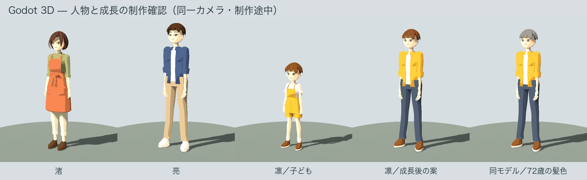
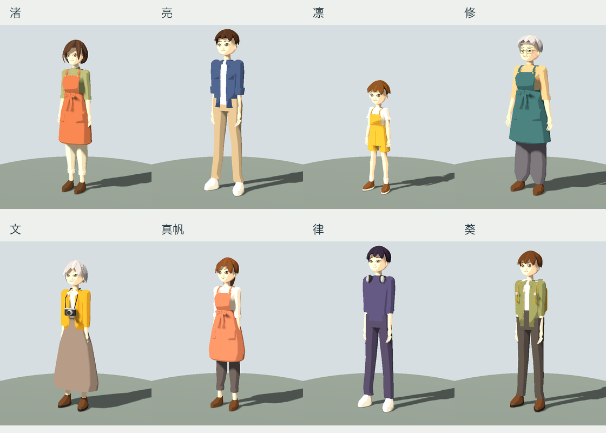

# v0.5 人物の表現 — 制作途中

2026年11月3日。v0.4は配布済み。v0.5では、住人8人全員と、成長後の凛を実際の3Dモデルへ置き換えている。人物の造形の最終確認と町の制作は継続中。

## 現在のゲーム内表現

35本の骨、6表情、9種類の動きを持つGLBを町で使用する。凛は7〜11歳の間に成長し、12歳から成人の頭身を持つモデルへ切り替わり、18歳までに成人の身長になる。これらは制作上の設定値であり、統計や個人の成長予測ではない。年齢の更新は保存データの再読み込みを挟まず、その場のモデルと名前表示に反映する。

歩行の再生速度は、モデルの歩幅に対応する設計速度と、実際の移動量から調整する。まばたき、交流時の微笑み、疲れを接続した。髪の色は年齢に応じて変えるが、加齢した顔や姿勢まで完成したことを意味しない。成長後の凛の外見は、子どもの原画と成人の体格をもとに推定している。

食事と休息は、実際の町の食卓・椅子・本人の寝床へ姿勢を合わせる。家具と小物10点を組み込み、着席時の腰と足、作業する手、食事中のカップ、仰向けに眠る頭を家具のマーカーへ合わせる。子どもは踏み台を使い、交流時は相手を見て着席したまま挨拶する。[家具と動作の156項目の確認](activities/README.md)と描画画像を保存した。





修は広い肩と丸眼鏡、文は長いスカートとカメラ、真帆はポニーテールと珊瑚色の前掛け、律はニットとヘッドホン、葵はフードとリュックを持つ。物を含む形状と体格を人物ごとに制作した。カメラなどの硬い物は胸へ固定し、長いスカートは腰・太腿・すねへ加重して、着席時に裾が下へ垂れるようにする。カップは実際に手と共に動く。カメラやラジオなど道具ごとの細かな操作と衣服の干渉は継続中。

## 確認したこと

Godot 4.7.2、macOS、Apple M5、Compatibilityで、日常49、人間関係33、仕事・家庭41、年月・人生50の計173項目が成功。家具の予約・経路・動作・保存互換の156項目もheadlessとGPUで成功した。9種類のモデルのスキン・実際の骨の歩行、着席による腰の下降、挨拶、6表情、LOD1/2の骨と表情、8人全員の町でのモデル使用、年齢によるモデル切り替えもheadlessとGPUで確認した。家具と接触を追加した後にも、人物と通し進行のGPU検査を再実行した。

加齢の指定値が届くことに加え、同じ姿勢の変更前後の画像を比較する。2px間隔の検査で、9モデルすべてで頭の領域は719〜1,051サンプルが変わり、頭以外の領域の変化は0だった。結果は `cast/aging-pixels.json`。子どものモデルへ72歳を指定する画像は髪のシェーダーの検査用であり、実際の町ではその年齢より前に成人の体格へ切り替わる。

新規開始、共同制作、3年の振り返り、88代表年の進行、最後の記録の画面まで、実際の3Dシーンで通し確認が成功。最新の画像を `integration/` に保存した。v0.4の確認画像は別フォルダに残す。

Godotのシーンエディタでは `character_stage.tscn` のCameraを選び、着席時の足元が操作バーと重ならないようFOVを30から34へ変更して保存した。通常の実行画面から、人物選択で亮・凛・成長後の凛へ切り替え、歩行・着席会話・挨拶をクリックして確認した。渚のBlenderマスターを実画面で編集した記録も維持する。

追加した5人も通常画面の人物選択から切り替えた。修の歩行、文の着席会話、真帆の挨拶ボタン、律の会話、葵の作業を操作した。自動のGPU検査では別途、9クリップと実際の変形を照合している。

Blenderでは、全モデルの加重・UV・三角形数、表情の中立値と変形量、全クリップ25時点の床との関係、ループの継ぎ目、3種類のGLBの空のシーンへの再読み込みを検査した。素材は2種類、画像3点をGLBに埋め込む。原画比較と推定箇所は[渚](../../../assets/models/CH_Nagisa/README.md)、[亮](../../../assets/models/CH_Ryo/README.md)、[凛](../../../assets/models/CH_Rin/README.md)、[成長後の凛](../../../assets/models/CH_RinAdult/README.md)に記載。

[修](../../../assets/models/CH_Osamu/README.md)、[文](../../../assets/models/CH_Fumi/README.md)、[真帆](../../../assets/models/CH_Maho/README.md)、[律](../../../assets/models/CH_Ritsu/README.md)、[葵](../../../assets/models/CH_Aoi/README.md)にも原画比較、寸法、三角形数、残る警告を保存した。追加5人はLOD0で30,008〜34,452三角形、全段階で35本の骨と9クリップを持つ。骨・UV・加重・予算などの失敗は0。近接頂点の警告と、真帆のLOD0の36面に関する向きの警告は記録を保持する。編集元とゲームへ渡したGLBのハッシュも一致している。

距離に応じたLOD1/2への切り替えを実装した。選択した人はLOD0を維持し、遠景の人はメッシュとスキンだけを切り替える。往復時に表示が細かく揺れないよう距離に幅を持たせた。骨、アニメーションの位相、表情、家具との接触、子どもから成人へのモデル変更をheadlessとGPUの各901項目で確認した。[9モデルの三角形数と検査記録](lod/checks.json)、[近景](lod/nagisa-lod0.png)、[簡略表示](lod/nagisa-lod2.png)、[寝台での接触](lod/nagisa-sleep-lod2.png)を保存する。フレームレートの向上自体は未測定。

## 残る作業

亮の正面輪郭IoUは0.897、凛は0.858で、formsの0.90基準には届いていない。渚は髪の輪郭の数値基準に達したが、衣服・素材・照明を含めた最終受け入れは未完了。制作途中の状態で機能を調べており、形状の最終一致を合格扱いにしない。

追加5人の実寸で合わせた正面輪郭IoUは0.8500〜0.8827で、formsの0.90基準には届いていない。全員の形状がそろった段階から、原画に近い髪と顔、衣服の折れと重なり、素材と照明の最終受け入れを継続する。

町・建物・家具・道具の最終造形、道具ごとの指先の操作、着席や起床の移り変わり、衣服や寝具の干渉、加齢後の顔と姿勢、昼夜の照明、音と演出は継続する。家具の到達誤差が許容内でも、見た目全体の受け入れを完了扱いにしない。v0.5のIssueとMilestone、Draft PRは開いたままにする。

## 再確認

```sh
python3 tools/verify_game.py --gpu
# 実行ファイルがPATHにない場合:
python3 tools/verify_game.py --godot /Applications/Godot.app/Contents/MacOS/Godot --gpu
# 通常の画面で人物と動きを切り替える:
godot --path . res://game/scenes/character_stage.tscn
```

検証スクリプトは終了コードだけでなく、エラーログと各テストの完了表示も照合し、未完了やタイムアウトを成功扱いにしない。CIでも同じheadless検証を使用する。GPUの画像比較は、実際に描画できる環境で実行する。
