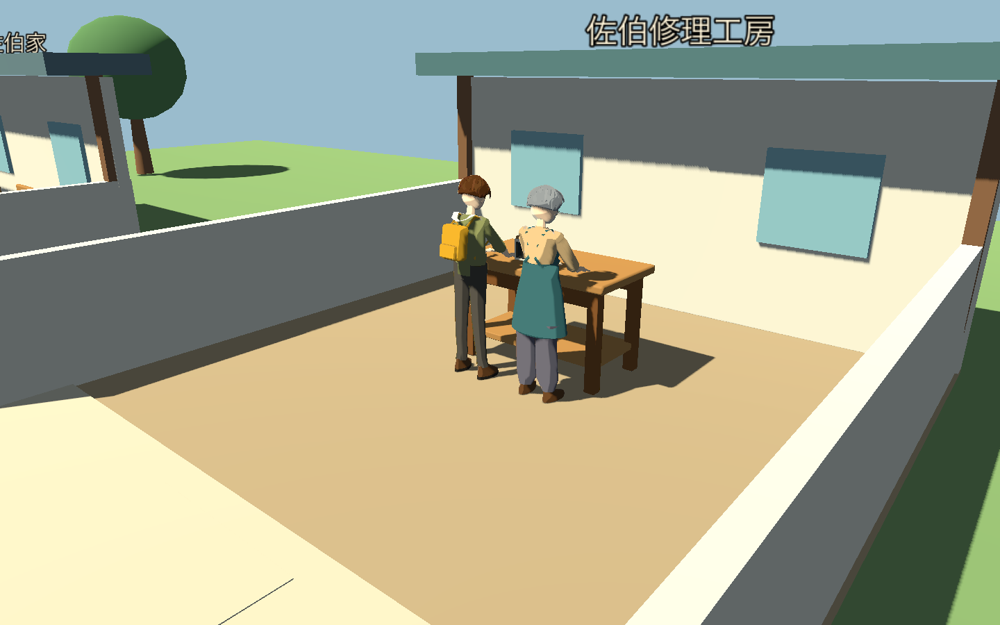
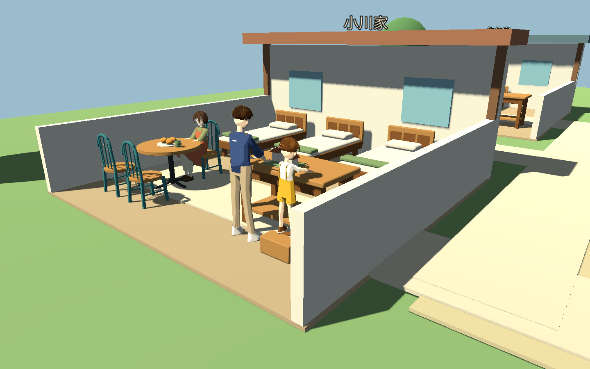
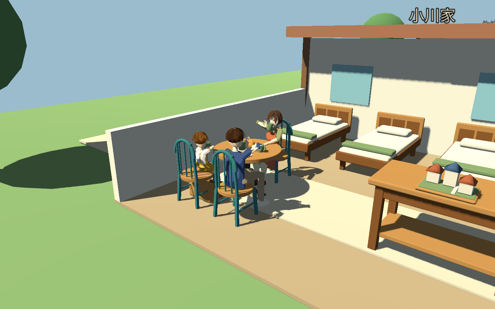
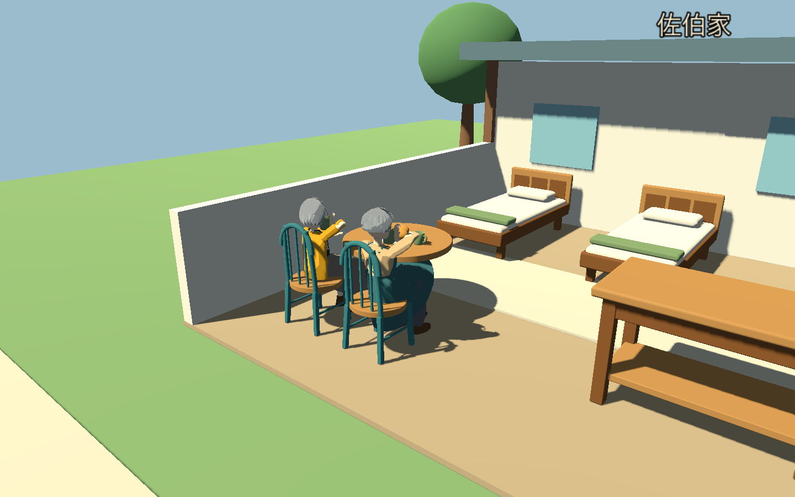
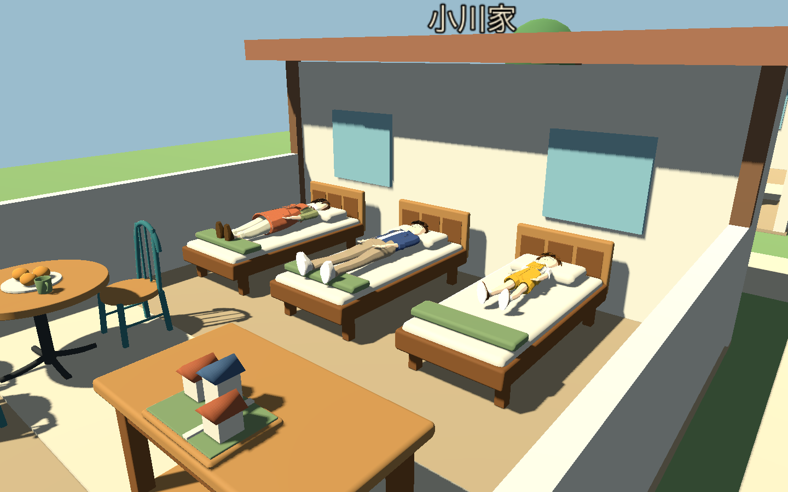
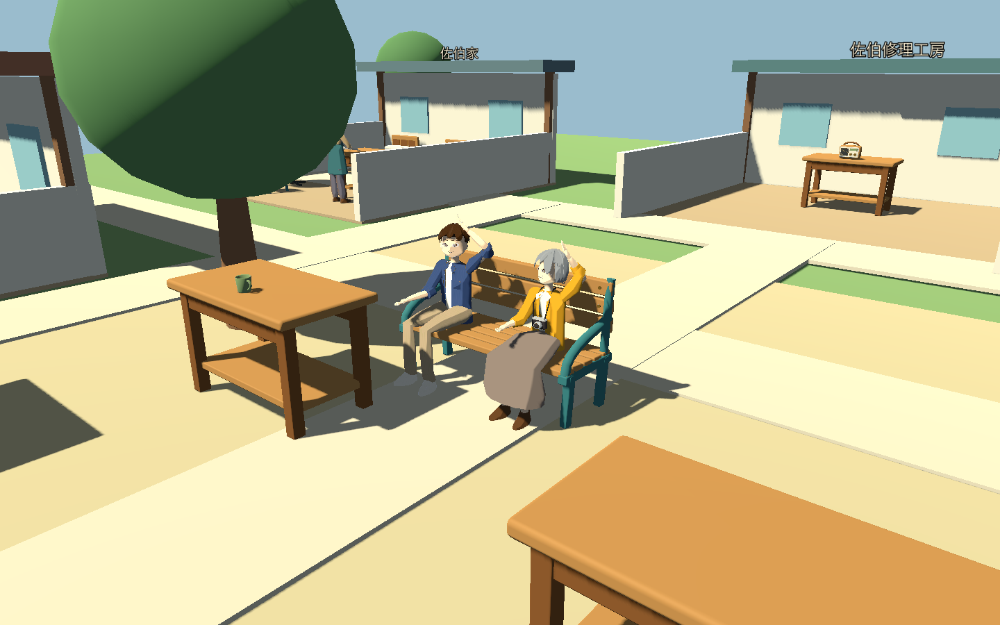

# 家具と住人の動きの確認

2026年11月3日、Godot 4.7.2 / macOS Apple M5 / Compatibility。制作途中の人物と家具を実際の町で使用し、着席、食事、共同作業、睡眠の位置合わせを確認した。自動検査156項目はheadlessとGPUの両方で成功。判定には目標位置だけでなく、Skeleton3Dの更新後の実際の骨の位置と方向を使う。

## 配置と行動

5室に36か所の行動位置を保存し、初期ベンチの2席を加えた38か所を使用する。`game/scenes/activity_layout.tscn` と `bench.tscn` では、家具とApproach、Contact、HandLeft、HandRightのマーカーを同じ親に持たせる。Godotのシーンエディタでも寝床のContactと家具の配置を確認した。マーカーの調整が移動先と描画の両方へ届く構成で、同じ位置を別の表へ手入力しない。

住人は移動を始めると席や作業場所を確保し、予定が変わると解放する。共同制作は二人分の空きがある場合に始まり、使用中なら材料を消費せず保留する。寝床は本人専用。室内では家具の占有範囲を避ける0.1m単位の経路を使用する。プレイヤーが置くベンチは公共の作業台と重なる位置へ置けない。

椅子の高さに腰を合わせ、両足は床または子どもの踏み台へ合わせる。作業中は手を作業面へ向け、体格の小さい凛は踏み台を使用する。食事中は実際のカップが手と一緒に動き、口元へ運ばれる。睡眠は仰向けのクリップに修正し、本人の枕へ頭を合わせる。交流では相手の頭へ視線を向け、着席したまま挨拶する。













## 検査の範囲

- 同じ席の重複予約、移動中の確保、予定変更による解放、交流参加者自身の席の再利用。
- 家具を避ける室内経路、使用中の作業台による共同制作の保留、材料の維持と解放後の受諾。
- 子どもの作業高さ、踏み台の表示、作業中の手の到達誤差4cm未満。
- 8人の着席とカップ、座面と腰の高さの差3cm未満、手と足の到達誤差4cm未満、飲む瞬間のカップ上端と口の距離12cm未満。
- 成人へ切り替わった凛の手と足の到達、子ども用の支持の解除。モデル切り替え時の0.2秒のブレンドが完了してから測定する。
- 8人の専用寝床、枕と頭の水平距離3cm未満、仰向けの方向。
- 相手への視線、着席したまま頭の高さまで手を上げる挨拶。
- 実際の保存と再読み込みによる割り当ての維持。新しい割り当てのない旧形式でも、位置を飛ばさず読み込める。

[測定値](contact-metrics.json)はGPU実行時の骨の位置と誤差。画像は動作と接触を見るための近接確認カメラで、通常のHUDと人物名を隠して撮影した。

## 制作を続ける箇所

手首や足の到達検査は、指先の接触や衣服の干渉まで保証しない。ダイヤル、カメラ、楽器などの道具ごとの操作、着席や起床の移り変わり、裾や寝具との重なりを引き続き制作する。現状では日常着と靴のまま眠る。写真・音楽・手芸の作業台の専用小物も継続中。屋外の全経路、旧保存データの既存の行動目標、ベンチと街路の配置の最終確認は残る。

```sh
python3 tools/verify_game.py --checks activities --gpu --output builds/verification-final-activities
```

位置と方向の補正にはGodotの[TwoBoneIK3D](https://docs.godotengine.org/en/4.6/classes/class_twoboneik3d.html)、[LookAtModifier3D](https://docs.godotengine.org/en/4.6/classes/class_lookatmodifier3d.html)と独自のSkeletonModifier3Dを使用する。参照した公式資料は4.6版、実行検証は4.7.2。
