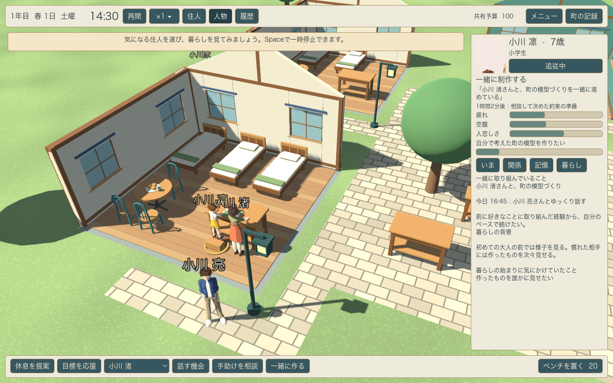
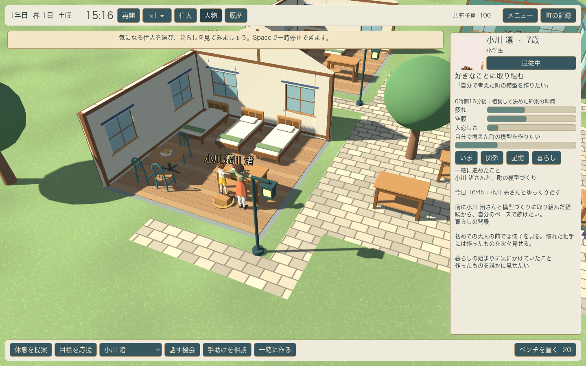

# v0.6 個性と経験 — 開発中

2026年11月3日。既存8人で、共同活動の定義、個人の知識、状況別の経験学習、自発的な共同作業を接続した。v0.6全体とv0.5の表現制作は未完了。[Issue #12](https://github.com/hayatok/hourglass_of_life/issues/12)と[開発計画](../../development-roadmap.md)で継続する。

## 実装した範囲

- ラジオ、模型、パン、写真、音楽、ものづくりの6活動を[data/resident-activities.json](../../../data/resident-activities.json)へ移した。制作相手の人物IDで分岐せず、関心、技能、本人が知る情報と、空いている実際の場所・時間から候補を作る。
- 住人が自分から共同作業を相談する。受け手も予定、疲れ、空腹、静かに過ごす必要、関心や関係から返答する。相談、移動、合流、実作業、完了・中断を計画として残す。
- 会話や制作の時間が合わないときは、二代表日以内で双方の日課、既存の約束、往復の時間を避けた枠を相談する。短く話したい人はカフェで15分の別案を選ぶ。合意時は予約だけを残し、実際の出発時に場所と生活条件を再確認する。再試行は上限を設ける。
- 家の負担や疲れから、本人が知る信頼する大人へ家事・世話の手助けを頼む。相手は自分の食事、休息、予定、関係から返答する。世話の担当者が食事や予定のため途中で交代するときは、元の担当者が本当に戻るまで子どものそばで待つ。実作業がなかった相談を技能や経験へ加算しない。
- 実際に成立した経験から、相手・場所・身体の状態に応じた期待と、練習した技能を緩やかに更新する。別の制作を楽しんだことだけで、対象の異なる願いを達成させない。
- 世界の事実と本人の知識を分け、直接見たか伝聞か、原出所、最後に伝えた人、時刻を保持する。既知の人の私的な技能変化も自動共有しない。以前に知ったことを、実際の会話を通して第三者へ伝えられる。
- 住人一覧・人物詳細・履歴を折り畳み、速度をメニューへまとめた。人物追従は近くへ寄り、パネルに隠れない画角へ調整する。人物画面には計画と経験からの受け止めを表示する。
- 新規開始の初期乱数を変え、開発用の`--world-seed=71103`指定と、知識・学習・途中の計画を含む保存・再開に対応した。旧schema 1〜4の欠落フィールドも読み込む。

初期の技能・関心、選択への補正、学習率、同意の評価はゲーム用の設計値。人間の行動を測定して得たモデルではない。ゲーム内の経験学習はローカルで動き、ネット検索や生成AIの実行は今回導入していない。

## 同じプレイの進行を追った描画

`tests/test_autonomy_presentation.gd`をGPUで実行した。seed 71103、プレイヤーからの提案なしで進め、住人発の活動を見つけてから完了まで同じプレイを追った。観察のための人物選択・追従・画面切替だけを行っている。

現在の実装とこの条件では、凛と渚の模型づくりの計画が14:17に始まり、14:30に実際に合流し、15:15に完了した。模型の技能値は凛が0.20から0.22、渚が0から0.03へ変わった。数値は架空のゲーム内技能を示す。

[同一プレイの時刻・相手・技能・知識・計画の記録](presentation/continuous-play.json)と[関係と履歴の画面](presentation/03-relations-and-history.png)を保存した。この一例が毎回起きることや、プレイヤーの楽しさを確認した記録ではない。模型づくりの作業台と子どもの踏み台は描画されるが、手で操作する専用の小道具や音・演技は未完成。

## 比較と回帰検証

Godot 4.7.2、macOS、Apple M5で検証した。[完了表示・ログ・実装ファイルのハッシュ](engine-checks.json)を保存する。

日常49、交流33、仕事と家庭41、年月50、認知89、活動定義24、自律行動23、将来の約束51、支援の計画41、家具と動作156、町96、HUD16の各検査が成功した。人物・全住人のモデル検査、距離によるLOD切り替え901項目、全員の生涯と最終記録までのGPUシーン検査、同一プレイのGPU表示7項目も成功した。認知と将来の約束の検査には、壊れた保存を町の状態を変えずに拒否する場合を含む。

保存後の再現では判断、相手、将来の予約と進行中の支援、事実と乱数状態を一致させ、連続値はJSON変換で生じる末尾の浮動小数点誤差だけを許容する。既存の会話予約との競合、距離の異なる二人の出発、合意後の空腹による保留、未参加での非達成、安全な世話の交代、別の活動へ進んだ人の計画を上書きしないこと、別れによる計画終了も検査した。

[10seed×12代表日・無介入と同じ初回提案の比較](autonomy-comparison.json)では、無介入でも共同作業が完了し、10条件で協力相手・活動の組合せが異なった。記録中の組合せは上限を設けた直近の計画履歴から集計している。人物の記憶から数えた参加経験は双方の参加分を含み、活動回数と同じ値ではない。これはルールの実行と条件差の確認であり、人間らしさや再プレイの面白さの評価ではない。

保持されている将来予約は、無介入の各条件で履行12〜26件、見送り34〜46件だった。自発的な支援の完了は0〜4件で、10条件中9条件に発生した。これらも履歴の保持上限があるため、期間全体の発生数ではない。実際の暮らしの変化に対して見送りが多い点を次の調整対象とする。出発準備と普段の行動、予定変更を知った後の相談、再予約の間隔と相手の選び方を同じseedで比較する。

HUDは1440×900と1280×800で描画し、[通常の観察](ui/01-observation-1440.png)、[履歴表示](ui/02-history-1440.png)、[1280幅](ui/03-observation-1280.png)を確認した。新規開始から最終の記録までの画面は[integration/](integration/)に保存する。

macOSの開発用ZIPも出力し、梱包した実行ファイルのheadless起動を確認した。資料・テスト・制作ツールの除外と、エンジンエラーがないことを[配布物の検査記録](package-check.json)へ保存する。公証済みの完成版ではなく、配布物の画面操作は別途確認する。

## 次に進めること

v0.6では将来予約の見送りを減らすため、準備と普段の行動をつなぎ、経験が選択へ及ぼす強さと理由の読み取りやすさを調整する。初見3〜5人の試遊は未実施。[約束と援助の調査R16・R17](../../research-notes.md#約束と援助の判断)を、変更理由、その後の履行、本人の余裕と支援の負担を比較する手掛かりにする。

v0.7では紹介、教え合い、分担、修復をさらに接続し、第三者へ伝わった知識が新たな協力や集まりへつながる様子を確かめる。v0.8の増員、v0.9の経験から変わる願いと人生、砂時計の振り返りは今後の開発として残る。人物・町の造形、道具別の演技、音と演出も継続する。
