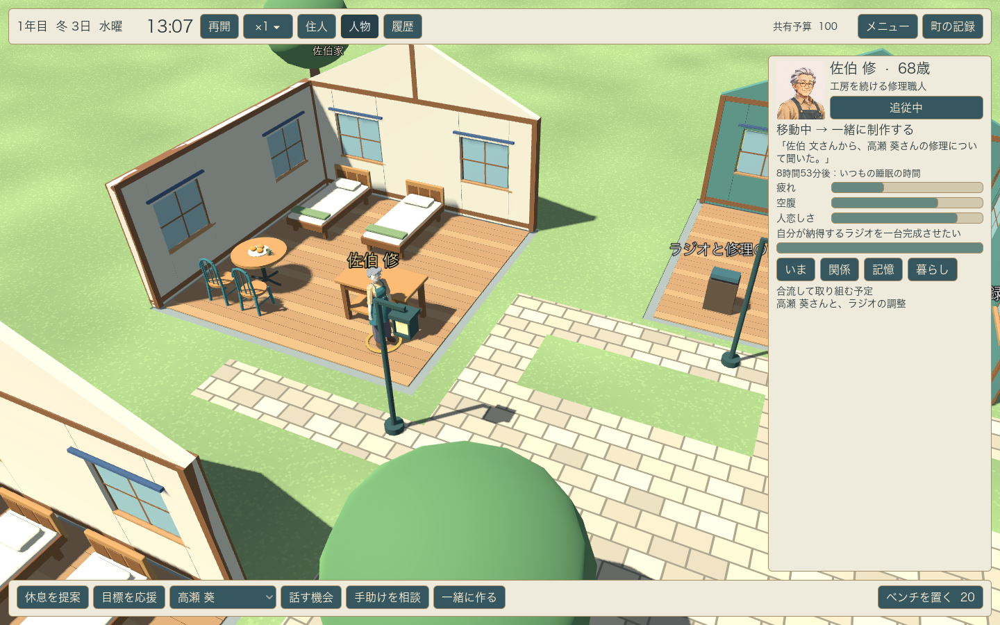

# v0.6 個性と経験 — 開発中

2026年11月3日。既存8人で、共同活動の定義、個人の知識、状況別の経験学習、自発的な共同作業を接続した。v0.6全体とv0.5の表現制作は未完了。[Issue #12](https://github.com/hayatok/hourglass_of_life/issues/12)と[開発計画](../../development-roadmap.md)で継続する。

## 実装した範囲

- ラジオ、模型、パン、写真、音楽、ものづくりの6活動を[data/resident-activities.json](../../../data/resident-activities.json)へ移した。制作相手の人物IDで分岐せず、関心、技能、本人が知る情報と、空いている実際の場所・時間から候補を作る。
- 住人が自分から共同作業を相談する。受け手も予定、疲れ、空腹、静かに過ごす必要、関心や関係から返答する。相談、移動、合流、実作業、完了・中断を計画として残す。
- 会話や制作の時間が合わないときは、二代表日以内で双方の日課、既存の約束、本人の食事・休息と往復の時間を見込んだ枠を相談する。短く話したい人はカフェで15分の別案を選ぶ。各自が準備・移動し、二人とも着いてから共有時間を始める。合意や準備だけでは成果を付けない。
- 都合が変わったときは双方の同意を再確認し、最大二回まで日程を取り直す。元の時刻、新しい時刻、相談した時刻と理由を保存する。途中で断った人の同意を迂回せず、終了した約束の移動と場所の確保は解除する。
- 家の負担や疲れから、本人が知る信頼する大人へ家事・世話の手助けを頼む。相手は自分の食事、休息、予定、関係から返答する。世話の担当者が食事や予定のため途中で交代するときは、元の担当者が本当に戻るまで子どものそばで待つ。実作業がなかった相談を技能や経験へ加算しない。
- 実際に成立した経験から、相手・場所・身体の状態に応じた期待と、練習した技能を緩やかに更新する。別の制作を楽しんだことだけで、対象の異なる願いを達成させない。
- 世界の事実と本人の知識を分け、直接見たか伝聞か、原出所、最後に伝えた人、時刻を保持する。既知の人の私的な技能変化も自動共有しない。以前に知ったことを、実際の会話を通して第三者へ伝えられる。
- 会話が実際に終わったとき、相手の関心や願いに合う人の技能を、話し手が持つ初期履歴と観察・伝聞から紹介する。過去の情報を今の技能として捏造せず、元の観察時刻を保持する。知人の存在を知ることと、親しくなること、実務の技能を得ることを分ける。
- 住人一覧・人物詳細・履歴を折り畳み、速度をメニューへまとめた。人物追従は近くへ寄り、パネルに隠れない画角へ調整する。人物画面には現在の相手、紹介元、直近の約束と完了結果を表示する。人物を切り替えたときは現在の活動相手を提案先の初期値にし、その後の手動選択は維持する。
- 新規開始の初期乱数を変え、開発用の`--world-seed=71103`指定と、知識・学習・途中の計画を含む保存・再開に対応した。旧schema 1〜4の欠落フィールドも読み込む。

初期の技能・関心、選択への補正、学習率、同意の評価はゲーム用の設計値。人間の行動を測定して得たモデルではない。ゲーム内の経験学習はローカルで動き、ネット検索や生成AIの実行は今回導入していない。

## 同じプレイの進行を追った描画

`tests/test_autonomy_presentation.gd`をGPUで実行した。seed 71103、プレイヤーからの提案なしで進め、住人発の活動を見つけてから完了まで同じプレイを追った。観察のための人物選択・追従・画面切替だけを行っている。

現在の実装とこの条件では、凛と渚がそれぞれ模型の作業台へ移動して待ち、14:32に共同作業を開始し、15:17に完了した。14:31の準備状態も直前のシミュレーションから保存した。模型の技能値は凛が0.20から0.22、渚が0から0.03へ変わった。数値は架空のゲーム内技能を示す。

[同一プレイの時刻・相手・技能・知識・計画の記録](presentation/continuous-play.json)と[関係と履歴の画面](presentation/03-relations-and-history.png)を保存した。この一例が毎回起きることや、プレイヤーの楽しさを確認した記録ではない。模型づくりの作業台と子どもの踏み台は描画されるが、手で操作する専用の小道具や音・演技は未完成。

## 紹介から後日の協力まで

`test_knowledge_exchange.gd`では、同じ人物・技能・関心の町で橋渡しの情報だけを除いた比較を行った。情報がある条件では、実会話で知った第三者との修理が候補になり、双方の同意、実際の移動と制作を経て技能と期待が変わる。情報がない条件では、その候補も練習も生じない。これは制御した検査条件であり、通常開始の町の発生頻度を示すものではない。

別に、通常の8人・無介入の有限探索で自然な連鎖を追った。seed 710〜719を各最大17,280分まで探索する条件を宣言し、710〜713では該当する制作が完了せず、714で見つかった。文から修へ葵の修理の話が伝わり、後日の13:07に修が葵とのラジオ調整を相談して移動を始め、14:28に合流して作業を開始、15:13に完了した。紹介を受けた時点で修の初期履歴に葵のプロフィールはなく、制作前の修から葵への親しみは0.05、信頼は0.2だった。元の情報の時刻、受領時刻、以前の関係と記憶も残す。

[同一プレイの紹介・活動・技能・関係の記録](social-chain/continuous-chain.json)、[合流](social-chain/02-actual-collaboration.png)、[完了後](social-chain/03-completed-result.png)、[表示の評価](social-chain/ui-review.json)を保存した。画像は紹介を受けた後の制作計画・作業・結果で、紹介を受けた瞬間の画像ではない。この観察だけで紹介が選択を引き起こしたと断定せず、制御した比較と区別する。

## 比較と回帰検証

Godot 4.7.2、macOS、Apple M5で検証した。[完了表示・ログ・実装ファイルのハッシュ](engine-checks.json)を保存する。

日常49、交流33、仕事と家庭41、年月50、認知105、情報共有67、活動定義24、自律行動23、将来の約束54、準備と日程変更34、支援の計画41、支援の参照36、家具と動作156、HUD33の各検査が成功した。町はheadlessで96、GPUで97項目が成功した。人物・全住人のモデル、LOD切り替え901項目、全員の最終記録までのGPUシーン、同一プレイのGPU表示7項目、紹介後の自然な連鎖のheadless・GPU各14項目も成功した。壊れた保存を町の状態を変えずに拒否する場合を含む。

保存後の再現では判断、相手、将来の予約と進行中の支援、事実と乱数状態を一致させ、連続値はJSON変換で生じる末尾の浮動小数点誤差だけを許容する。既存の会話予約との競合、距離の異なる二人の出発、合意後の空腹による保留、未参加での非達成、安全な世話の交代、別の活動へ進んだ人の計画を上書きしないこと、別れによる計画終了も検査した。

[10seed×12代表日・無介入と同じ初回提案の比較](autonomy-comparison.json)では、無介入でも共同作業が完了し、10条件で協力相手・活動の組合せが異なった。記録中の組合せは上限を設けた直近の計画履歴から集計している。人物の記憶から数えた参加経験は双方の参加分を含み、活動回数と同じ値ではない。これはルールの実行と条件差の確認であり、人間らしさや再プレイの面白さの評価ではない。

将来予約は[履歴の保持上限に依存しない変更前後の比較](agenda-comparison/comparison.json)も行った。8人、seed 710〜719、各16,500分、無介入と同じ初回提案の条件をそろえ、終了イベントを同期して集計した。以下は無介入10条件の合計。日程を取り直しても同じ相談案件として数える。「当初の日時で参加」は、合流の許容時間を含め、日程変更を行わずに成立した案件を指す。

| 集計 | 変更前 254713f | 今回の実装 |
|---|---:|---:|
| 新しい相談案件 | 622 | 406 |
| 当初の日時で参加 | 197 | 153 |
| 日程変更後に参加 | 0 | 104 |
| 最終的な見送り | 403 | 133 |
| 期間末の未完了 | 22 | 16 |
| 新しい日時の再相談 | 0 | 242 |

実際に参加まで進んだ案件は197件から257件へ増えたが、当初の日時で参加した件数や、新規の相談数は減っている。見送りのうち、食事・休息は233件から64件、移動見込みの変化は133件から27件だった。準備・経路・紹介など複数の変更を含むため、個別の効果を分離した比較ではない。未完了を成功や失敗に含めず、件数だけで面白さを判断しない。

長時間進行の負荷も調べ、本人が知るプロフィールの重複構築と、相手ごとの記憶の再走査を減らした。終了した支援の履歴は保存し、現在有効な支援だけを日課の判定で再利用する。キャッシュを使わない参照実装と、実際の引継ぎ・死亡・保存・再開後の状態と乱数を比較した。[支援判定10万回の局所測定](support-index-performance.json)では、終了履歴42件で525.7msから28.6msへ短縮した。ゲーム全体やフレームレートの速度を示す値ではない。

HUDは1440×900と1280×800で描画し、[通常の観察](ui/01-observation-1440.png)、[履歴表示](ui/02-history-1440.png)、[1280幅](ui/03-observation-1280.png)を確認した。新規開始から最終の記録までの画面は[integration/](integration/)に保存する。

macOSの開発用ZIPを出力し、梱包後のheadless起動、資料・テスト・制作ツールの除外を[配布物の検査記録](package-check.json)へ保存した。梱包したアプリをネイティブUI操作でも確認し、新規開始、人物選択、追従、一覧の開閉、Space一時停止、保存、進行後の再読込を確かめた。[操作記録](package-ui-check.json)に範囲を残す。既存の保存2ファイルは退避し、終了後に元のハッシュへ復元した。エージェントによる操作検証であり、人間の試遊や公証済みの完成版として扱わない。

## 次に進めること

v0.6では経験が選択へ及ぼす強さと、理由・結果の読み取りやすさを調整する。約束を取り直す負担、当初の日時で参加できる機会、忙しい人と余裕のある人の違いも比較する。初見3〜5人の試遊は未実施。[約束と援助の調査R16・R17](../../research-notes.md#約束と援助の判断)を、変更理由、その後の履行、本人の余裕と支援の負担を比較する手掛かりにする。

v0.7では教わった人が別の人の役に立つ連鎖、行き違い後の信頼の修復、複数人の集まりへ広げる。v0.8の増員、v0.9の経験から変わる願いと人生、砂時計の振り返りは今後の開発として残る。人物・町の造形、道具別の演技、音と演出、3Dの名前や記録物の文字の重なりも継続する。
